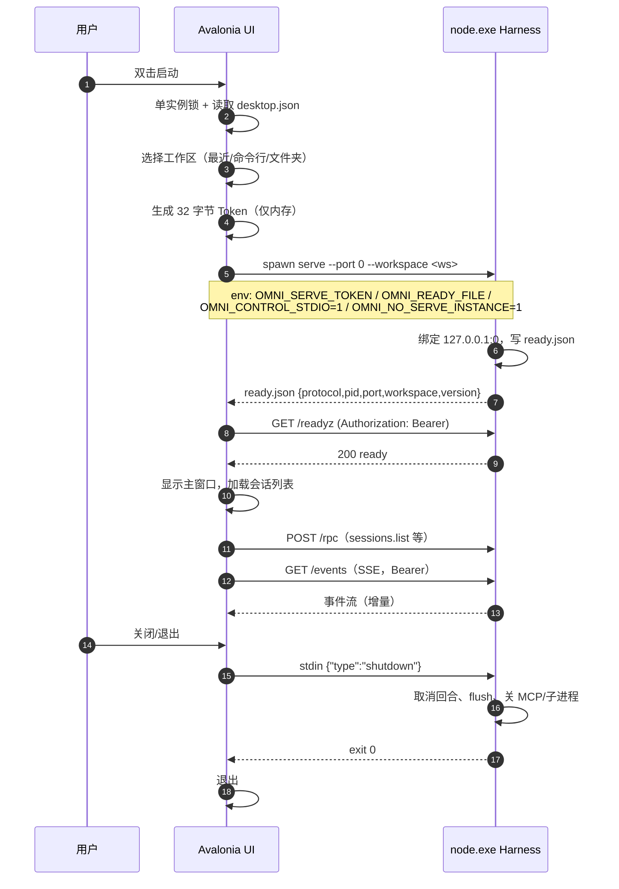

# OmniHarness 桌面应用技术方案（原生 UI 版）

> **后续变更（2026-10-24）**：用户最终选择 **按 Codex 官方 App 的 Electron + React/TS 方式**完成；
> 本文转为**历史/备选研究**（Avalonia 原生路线），不再代表当前架构。当前实施见
> [ADR-0017](./adr/0017-electron-official-app.md) 与 [desktop/README.md](../desktop/README.md)。  
> **版本**：v2（2026-10-24）  
> **状态**：历史研究（已被 ADR-0017 取代）  
> **变更**：v1 的 **Electron 套壳方案曾被否决**（用户要求“不做套壳”），因此本文改为原生 UI；
> 随后用户改选官方 App 路线，Electron 方案以 ADR-0017 重启。  
> **结论先行**：**Avalonia 12.1 + .NET 10 + LiveMarkdown.Avalonia + Node 24 侧车（Harness）**。WinUI 3（Windows App SDK 2.5）是 Windows-only 的强备选；Electron / Tauri / WebView2 主界面在本方案中不做。  
> **一句话架构**：`Avalonia 原生 UI 进程（无 Chromium/WebView） → HTTP/SSE（Bearer）→ Node 侧车（Harness）→ N-API → Rust 内核`。

---

## 0. 摘要

| 决策项             | 结论                                                                             | 理由                                                                         |
| ------------------ | -------------------------------------------------------------------------------- | ---------------------------------------------------------------------------- |
| 主界面             | **Avalonia 12.1.x + .NET 10**                                                    | 无 WebView、跨平台、MIT、富文本生态最贴合 AI 聊天；12.x 性能/无障碍/IME 成熟 |
| Markdown/数学/代码 | **LiveMarkdown.Avalonia 2.5.x**（Apache-2.0）                                    | 专为 LLM 流式输出设计：增量渲染、LaTeX、Mermaid、代码高亮、表格、可选择文本  |
| Windows-only 备选  | **WinUI 3 / Windows App SDK 2.5**                                                | 真原生 Fluent 控件、IME/无障碍最佳；但 Windows-only，Markdown/数学需更多自研 |
| Harness            | **Node 24 LTS 侧车**，现有 HTTP/SSE 契约                                         | 复用全部 Agent/工具/沙箱/会话能力；原生客户端只是另一个服务客户端            |
| 进程模型           | UI 进程 + Node 侧车 + Harness 子进程                                             | 无 Chromium；UI 崩溃不带走 Harness，Harness 崩溃可重启                       |
| 打包/更新          | **Velopack 1.2** + 代码签名 + GitHub Releases                                    | .NET 原生安装器、差分更新、跨平台；比 MSIX 更适合独立开发者                  |
| 不做什么           | 不做 Electron/Tauri/WebView 主界面；不把 React 组件硬塞进原生控件；不承诺 6–8 周 | 这是“原生”的代价，必须先说清                                                 |
| 工期               | Windows Beta **6–8 个月**（2 名工程师）；跨平台 GA **10–14 个月**                | 不含模型/产品新功能；1 人约 10–12 个月                                       |

**三个必须先接受的事实**：

1. **“不做套壳”不是换一个壳，而是重写 UI 层**。现有 Web 工作台是 172 个源文件 / 26,573 行 TS/TSX、62 个 TSX 组件、259 KB CSS、99 个测试文件 / 14,036 行测试。原生方案不能复用这些组件与 DOM 判据，只能复用 Harness、协议、设计 token 与产品语义。
2. **“原生”在本方案中 = 无浏览器引擎、无 HTML/CSS/JS 主界面**。Avalonia 用 Skia 自绘控件树（不是 Win32 原生控件）；WinUI 3 用系统 Fluent 控件。两者都满足“不做套壳”，但“原生感”不同，见 §3。
3. **Node 侧车仍是必需的**。Harness 是产品的核心资产；桌面 UI 只替换“浏览器客户端”，不替换 Agent 运行时。侧车的 `process.execPath`、N-API、插件 Worker、沙箱语义保持不变。

---

## 1. 需求与判定标准

### 1.1 “不做套壳”的操作性定义

| 层级 | 形态                                                       | 是否接受            | 说明                                        |
| ---- | ---------------------------------------------------------- | ------------------- | ------------------------------------------- |
| L0   | Electron/Tauri 把现有 Web UI 整体装进 WebView              | ❌                  | 典型套壳；主界面仍是浏览器                  |
| L1   | 原生窗口壳 + 全部内容用 WebView2                           | ❌                  | 只是换了窗口边框，本质仍是 Web UI           |
| L2   | 原生主界面 + **局部** WebView 仅用于隔离的 HTML 预览       | ⚠️ 仅作为功能级例外 | 例如工作区网页预览；v1 优先用系统浏览器代替 |
| L3   | **原生 UI 树/控件、原生输入/焦点/无障碍/渲染，无 WebView** | ✅ **目标**         | Avalonia / WinUI 3 / WPF 等                 |

本文按 **L3** 设计。若只是“不要 Electron、但 WebView 可以接受”，应直接选 Tauri 2（约 3–4 周），不需要本文的 6–8 个月——但那仍然属于 L0/L1，不满足“不做套壳”。

### 1.2 质量属性（按优先级）

| 权重 | 属性                   | 具体要求                                                                      |
| ---: | ---------------------- | ----------------------------------------------------------------------------- |
|  25% | **富文本/AI 聊天体验** | 流式 Markdown、代码高亮、LaTeX、表格、Mermaid、长会话虚拟化、可选择/复制/搜索 |
|  20% | **原生体验 / OS 集成** | 托盘、通知、文件对话框、深链、单实例、开机启动、窗口状态、高 DPI、主题        |
|  15% | **中文输入 / 无障碍**  | 微软拼音/搜狗等 IME 组合、候选、提交不丢字；Narrator/键盘/高对比度            |
|  15% | **交付与团队**         | 团队以 TS/Rust 为主，新语言学习成本；招聘/外包可行性；文档与生态              |
|  10% | **跨平台**             | Windows 优先；macOS 后续；Linux 尽力                                          |
|  10% | **性能/内存**          | 冷启动、长会话滚动、流式帧率；无 Chromium 的收益要兑现                        |
|   5% | **打包/更新/签名**     | 安装器、差分更新、代码签名、回滚、企业部署                                    |

### 1.3 非目标

- 不做“原生外壳 + WebView 内容”的伪原生；主界面不允许出现 HTML 渲染。
- 不在 v1 做内置终端/代码编辑器/多窗口；先做到核心工作流对等。
- 不在 v1 支持 32 位 Windows；Windows ARM64 视 .NET/Avalonia 支持另行验证。
- 不承诺“绿色便携版”；数据仍在 `~/.omniharness`，真正便携需要 `OMNI_HOME` 改造。

---

## 2. 现状盘点：能复用与不能复用

### 2.1 可复用（桌面化的真正资产）

| 资产         | 现状                                                             | 原生客户端如何复用                             |
| ------------ | ---------------------------------------------------------------- | ---------------------------------------------- |
| Harness 服务 | `serve`：HTTP/SSE、工作区、配置分层、会话、审批、沙箱、插件、MCP | **原样运行**；原生客户端通过 HTTP/SSE 调用     |
| 协议         | JSON-RPC 2.0 + SSE；`protocol.md` / schema / `omni-sdk-gen`      | 从 schema 生成 C# DTO；契约测试防漂移          |
| CLI          | `serve/exec/doctor/...`；`--port 0`、Token、实例记录             | 侧车直接跑 `serve`；诊断复用 `doctor`          |
| 原生内核     | Windows N-API `.node`；Node 24 实测 `ping` 成功                  | 仍在 Node 侧车内加载；UI 不直接 P/Invoke       |
| 设计 token   | `web/styles/tokens.css`、`DESIGN_SYSTEM.md`                      | 抽成 JSON → 生成 Avalonia `ResourceDictionary` |
| 文案/i18n    | `web/src/ui/i18n/{zh,en}`                                        | 抽成 JSON/ResX，原生端复用同一份文案           |
| 产品语义     | 会话、回合、工具卡、审批、检查点、成本                           | 原样建模为 ViewModel/Store                     |
| Harness 测试 | 大量 Node 单测/集成                                              | 继续跑；桌面只加客户端测试                     |

### 2.2 不能复用（必须重写）

| 资产       | 规模                                                                                 | 影响                                                                     |
| ---------- | ------------------------------------------------------------------------------------ | ------------------------------------------------------------------------ |
| React 组件 | 62 个 TSX / 172 个文件 / 26,573 行                                                   | 全部重写为 Avalonia `UserControl`/`ControlTheme`                         |
| CSS        | 259 KB / 约 40 个样式表                                                              | 不能 1:1 翻译；按设计 token + 组件状态重做                               |
| DOM 行为   | 虚拟滚动、ResizeObserver、IntersectionObserver、`content-visibility`、选区、滚动锚定 | 用 Avalonia 布局/虚拟化/滚动 API 重写                                    |
| 前端测试   | 99 个测试 / 14,036 行；真 Chrome、jsdom、a11y、响应式                                | 大部分不可直接复用；改为 headless Avalonia + Appium + 视觉回归           |
| 浏览器预览 | 右栏 iframe（独立回环端口）                                                          | 原生端 v1 改为“在系统浏览器打开”；后续如需内嵌，用隔离 WebView2 仅做预览 |

> **这就是 6–8 个月的来源**：不是“换个框架编译一下”，而是把 2.6 万行 UI 逻辑与 259 KB 样式重新实现，并补齐 IME/无障碍/原生集成。

### 2.3 与 UI 框架无关、但必须先修的 Harness 前置

这四条在 v1（Electron）调研中已实测，换成原生 UI 仍然成立：

1. **`--experimental-permission` 必须改 `--permission`**：Node 24.22.1 / Electron 44.7（Node 24.21）直接报 `bad option`；`--permission` 在 Node 22.20、24.22.1、Electron 44.7 均可用。位置：`src/plugin/worker/workerSpawnSpecBuilder.ts:48`。
2. **就绪文件**：新增 `OMNI_READY_FILE`，在 `runHttpServe` 绑定成功后原子写 `{protocol,pid,port,workspace,version,apiVersion}`；原生客户端不解析 stdout。
3. **优雅退出**：新增 `OMNI_CONTROL_STDIO` stdin 控制通道；Windows 上 `child.kill()` 不是可捕获的优雅信号，必须用 stdin `{"type":"shutdown"}` + EOF 兜底 + `taskkill /T /F` 兜底。
4. **Token 不落盘、不进日志**：桌面生成 32 字节 Token，经 `OMNI_SERVE_TOKEN` 注入；`runHttpServe` 目前仍会打印带 `?token=` 的横幅，需要 `OMNI_NO_UI_URL=1` 抑制；日志再做脱敏。

另加两条：

- `--port 0` 时 `ServeInstance.sweep(pathFor(0))` 与 `announce(实际端口)` 路径不一致；桌面模式用 `OMNI_NO_SERVE_INSTANCE=1` 跳过实例记录。
- 模型/向量缓存默认落在包根 `third-party/`；安装到 Program Files 会不可写。桌面必须设 `OMNI_EMBEDDING_CACHE_DIR` / `OMNI_VEC_CACHE` 到 `%LOCALAPPDATA%`。

### 2.4 本机已实测（2026-10-24）

| 测试                                                        | 结果                                                                                                       |
| ----------------------------------------------------------- | ---------------------------------------------------------------------------------------------------------- |
| Node 24.22.1 跑 `dist/src/cli/exec.js --version`            | ✅                                                                                                         |
| Node 24.22.1 `serve --port 0 --mock`                        | ✅ 随机端口 + Token URL                                                                                    |
| Node 24.22.1 加载 `native/omni_napi.node` 并 `ping`         | ✅ `{"native":true,"ok":true,"pong":true}`                                                                 |
| Node 24.22.1 `--experimental-permission`                    | ❌ `bad option`                                                                                            |
| Node 24.22.1 `--permission`                                 | ✅                                                                                                         |
| Electron 44.7.0（`ELECTRON_RUN_AS_NODE=1`）加载同一 `.node` | ✅ `ping`                                                                                                  |
| Electron 45 GUI 启动                                        | ⚠️ 本会话 DSH 沙箱内 `STATUS_BREAKPOINT`，未完成 GUI 验证（与原生方案无关，但说明本环境不能做 GUI 级验收） |

---

## 3. 候选技术调研（无 WebView）

### 3.1 事实基线（截至 2026-10-24）

| 技术                      | 最新版本                                | 渲染/运行时               | 平台              | 与本项目的关键事实                                                       |
| ------------------------- | --------------------------------------- | ------------------------- | ----------------- | ------------------------------------------------------------------------ |
| **Avalonia**              | **12.1.4**（2026-10-09）                | Skia 自绘控件树 + .NET 10 | Win/macOS/Linux   | MIT；12.x 大幅提升渲染/无障碍/IME；NativeAOT 可用                        |
| **WinUI 3**               | **Windows App SDK 2.5.1**（2026-09-16） | 原生 Fluent/XAML + .NET   | Windows only      | 真原生控件/IME/无障碍；无官方 DataGrid/可视化设计器；Markdown/数学需自研 |
| **WPF**                   | .NET 10                                 | 原生 XAML/DirectX         | Windows only      | 成熟稳定；Fluent 主题；无跨平台；生态偏旧                                |
| **Uno Platform**          | 6.6（2026-08）                          | WinUI XAML + Skia/WinUI   | 多平台            | 可复用 WinUI XAML；复杂度高；桌面生态不如 Avalonia                       |
| **Flutter**               | **3.47.8**（2026-10-23）                | Impeller/Skia 自绘        | 多平台            | 自定义 UI 强；Windows IME 仍有未闭环问题（见 §3.4）                      |
| **Qt**                    | 6.10+                                   | 原生 Qt Widgets/QML       | 多平台            | 文本排版顶级；C++/QML、LGPL/商业许可；数学/Markdown 需自研               |
| **Slint**                 | 1.18（2026-09-16）                      | Rust 自绘                 | 多平台            | 轻量；富文本/Markdown/数学生态弱                                         |
| **Compose Multiplatform** | 1.9+                                    | Kotlin/JVM + Skia         | 多平台            | JVM 运行时；Kotlin 新栈；富文本生态较弱                                  |
| **React Native Windows**  | 0.85（2026-10-21）                      | WinUI 原生控件 + JS       | Windows（+macOS） | TS/React 心智可复用；但桌面生态窄、IME/文本/无障碍仍需验证               |
| **egui**                  | 持续                                    | Rust 即时模式             | 多平台            | 不适合富文本聊天/无障碍                                                  |
| **GPUI**                  | Zed 1.0（2026-04-29）                   | Rust GPU 自绘             | Win/macOS/Linux   | Zed 的**内部框架**，不是通用 SDK；无稳定文档/生态                        |
| **Electron / Tauri**      | 45 / 2.12                               | Chromium/系统 WebView     | 多平台            | 仍是 WebView 套壳；按需求否决                                            |

### 3.2 第一轮筛选：先排除“仍然是 WebView”的

- **Electron 45**：主界面仍是 Chromium；无论打包多好，都是 L0。
- **Tauri 2.12**：Rust 核心 + 系统 WebView；UI 仍是 HTML/CSS/JS，仍是 L0/L1。
- **NW.js / Neutralino / WebView2 混合**：同理。

> 如果产品目标只是“不要 Electron，但 WebView 可以”，Tauri 2 是合理选择：3–4 周可复用现有 React UI，安装包更小。但它**不满足本文的“不做套壳”**，故不进入主推荐。

### 3.3 第二轮：原生候选中，为什么是 Avalonia 而不是其他

#### 3.3.1 Avalonia 12.1：最贴合“AI 聊天 + 自定义设计 + 跨平台”

**关键优势**：

1. **富文本/流式渲染有现成的高质量开源件**：`LiveMarkdown.Avalonia` 2.5.1（Apache-2.0，2026-10-22）专为 LLM 流式输出设计，支持 Markdig、TextMateSharp 代码高亮、LaTeX（RaTeX）、Mermaid（Mermaider）、表格、图片、可选择文本、搜索高亮、增量 `ObservableStringBuilder`。它还明确支持“Append/Clear”的流式模型，正好对应 SSE 增量。
2. **不是“拿网页糊一层”**：控件树、文本布局、输入、焦点、无障碍都是 Avalonia 自己的；Windows 用 UIA、macOS 用 NSAccessibility、Linux 用 AT-SPI2。
3. **中文 IME 是一等公民**：官方文档明确 Windows/macOS/Linux 的 IME 支持为 Full；`TextBox` 自带组合/候选/提交，不必自己实现 IME。
4. **12.x 的性能与无障碍补强**：官方称复杂场景最高 1,867% FPS 提升；新增 Linux AT-SPI2 无障碍、导航控件、焦点管理重做；目标 .NET 10。
5. **NativeAOT 可用**：可自包含、无 .NET 运行时依赖、启动更快、攻击面更小；但第三方控件需逐项验证 AOT 兼容性。
6. **测试/工程化完整**：`Avalonia.Headless.XUnit` 可做 UI 单测；官方支持 Appium UI 测试；TrayIcon、NativeMenu、StorageProvider、剪贴板、拖放都是内置。
7. **MIT 许可**：框架可免费商用；部分工具/高级控件是商业产品，但本文选用的 LiveMarkdown 是 Apache-2.0，不依赖付费组件。
8. **生产案例**：`Everywhere`（约 6.3k stars 的桌面 AI 助手，MCP/多 LLM）使用 LiveMarkdown.Avalonia；dotMemory、Lunacy 等商业应用使用 Avalonia。

**代价/风险**：

- 自绘控件不是 Win32 原生控件；Windows 上的“原生感”不如 WinUI 3，需用 Fluent 主题 + Mica + 自定义 chrome 贴近。
- 团队没有 C#/XAML 经验；需要 4–6 周 ramp-up。
- OS toast 没有内置（TrayIcon 有，但系统 Toast 要平台服务）；单实例/深链/全局热键需要自己封一层。
- 第三方 Markdown/数学控件的 AOT 兼容性要实测；不兼容就退回自包含（非 AOT）。
- **LiveMarkdown 本身是较新的社区项目**（2.5.1 发布时下载量还很小），维护集中在少数作者；必须锁定版本、做视觉/性能回归，并准备 Apache-2.0 源码 fork/vendor 的预案。

#### 3.3.2 WinUI 3：Windows-only 的“最原生”，但富文本要自研

**优势**：

- 真正的 Fluent 控件、Mica、系统 IME、UIA 无障碍、Windows 通知/任务栏集成最好。
- Windows App SDK 2.5 稳定，微软持续投入；MSIX + App Installer 可做企业级更新。
- C#/XAML 与 Avalonia 学习曲线相近；如果产品 100% 锁定 Windows，这是最“像 Windows 应用”的选择。

**硬伤**：

- **Windows-only**：macOS/Linux 要另写一套；本项目已有跨平台 CLI/Web，桌面端锁死 Windows 是产品战略问题。
- **没有官方 DataGrid、没有可视化 XAML 设计器**（社区 2026 评估仍指出）；聊天 UI 不用 DataGrid，但工具/成本表格会用到。
- **Markdown/数学没有 Avalonia 那样的“开箱即用”**：Community Toolkit 有 `MarkdownTextBlock`，但数学/流式/代码高亮/Mermaid 需组合自研；RichEditBox 的 `SetMathMode` 是 Windows App SDK 2.0 experimental，且要把 LaTeX 转 OMML，链路长。
- **更新/打包更重**：MSIX 需要包身份、签名、App Installer；对独立开发者不如 Velopack 直接。

**结论**：WinUI 3 是“Windows-only + 原生控件优先”的强备选；用 Phase 0 bake-off 与 Avalonia 对比后再定。若 bake-off 发现 Avalonia 的 IME/无障碍/文本保真不达标，切 WinUI 3。

#### 3.3.3 Flutter：自定义 UI 很强，但 Windows IME 是红线

Flutter 3.47.8 的渲染/自定义 UI 很适合聊天界面，`flutter_math_fork` 也能渲染 TeX。但 2026 年 Windows 上仍有未闭环的 IME 缺陷：

- `[Windows][IME] Composition stops after the Flutter view regains focus`（#190042）
- `[Windows] TextField with maxLines: 1 duplicates text with IMEs that commit on Space`（#191194）

对一个中文优先的 Agent 工作台，输入框丢字/重复字是阻断级缺陷。再加上桌面插件/无障碍/托盘/更新生态不如 Avalonia/WinUI 成熟，**不推荐**。

#### 3.3.4 Qt：文本最强，但团队/许可/数学不划算

Qt 的文本排版、IME、无障碍、跨平台都成熟；但：

- C++/QML 双栈，团队以 TS/Rust 为主，学习/招聘成本高；
- LGPLv3（动态链接）或商业许可，闭源分发需合规评估；
- Markdown 可用 `QTextDocument::setMarkdown`，但 LaTeX/数学没有 KaTeX 级方案，需自带渲染器或 WebEngine（又回到 WebView）；
- 打包体积/部署复杂度高。

**结论**：如果团队已有 Qt 专家，Qt 是强候选；对本项目不是最优。

#### 3.3.5 Rust UI（Slint / egui / GPUI）：方向对，生态不够

- **Slint 1.18**：Rust 原生、轻量、声明式；但富文本/Markdown/数学/流式聊天组件几乎都要自研；生态与招聘面窄。
- **egui**：即时模式，适合工具面板，不适合长文本、选区、无障碍、IME 复杂的聊天。
- **GPUI**：Zed 1.0 证明了 Rust GPU UI 能做到极致性能，但 GPUI 是 Zed 的内部框架，不是给第三方应用用的稳定 SDK；没有文档/生态/版本承诺。
- **Dioxus**：桌面默认仍是 WebView，Blitz 渲染器尚早；不满足“无 WebView”。

#### 3.3.6 React Native Windows：心智复用，但桌面生态太窄

RNW 0.85 已切到 New Architecture，要求 VS 2026 / .NET 10 / Windows App SDK 1.8；文本/IME/无障碍有修复。它能让 React 团队复用组件心智，但：

- 不是 DOM/CSS，现有 26k 行 React 组件不能直接复用；
- 桌面端（托盘/深链/多窗口/更新）生态远小于 Avalonia/WinUI；
- Markdown/数学/代码高亮多为移动端包，桌面适配要自己填；
- 仍然要 C++ 工具链。

**结论**：不作为主方案；若团队坚决要 React 且 Windows-only，可作为备选评估，但风险高于 Avalonia。

### 3.4 加权评分（工程判断）

权重：富文本/聊天 25%、原生体验 20%、无 WebView/安全 15%、跨平台 10%、团队/生态/交付 15%、性能/内存 10%、打包/更新 5%。

| 方案              | 富文本 | 原生体验 | 无 WebView | 跨平台 | 团队/生态 | 性能 | 打包 |   加权 |
| ----------------- | -----: | -------: | ---------: | -----: | --------: | ---: | ---: | -----: |
| **Avalonia 12.1** |      5 |        4 |          5 |      5 |         3 |    5 |    4 | **89** |
| **WinUI 3**       |      3 |        5 |          5 |      1 |         3 |    5 |    5 | **76** |
| Qt 6.10           |      4 |        5 |          5 |      5 |         1 |    5 |    2 | **80** |
| WPF               |      3 |        4 |          5 |      1 |         3 |    4 |    4 | **69** |
| Flutter 3.47      |      4 |        2 |          5 |      5 |         2 |    4 |    3 | **70** |
| Slint 1.18        |      2 |        4 |          5 |      4 |         3 |    5 |    4 | **72** |
| RNW 0.85          |      3 |        4 |          5 |      3 |         2 |    4 |    4 | **70** |
| Compose MP        |      3 |        3 |          5 |      5 |         2 |    3 |    3 | **67** |
| egui              |      2 |        3 |          5 |      4 |         3 |    5 |    4 | **68** |
| GPUI              |      2 |        4 |          5 |      2 |         1 |    5 |    3 | **61** |
| Tauri 2.12        |      5 |        2 |          1 |      5 |         4 |    3 |    5 | **69** |
| Electron 45       |      5 |        2 |          1 |      5 |         5 |    3 |    5 | **72** |

> 分数用于暴露取舍，不是 benchmark。Qt 分数不低，但团队/许可/数学三项是硬约束；Tauri/Electron 的“无 WebView”为 1，直接不满足需求。

### 3.5 开源社区可借鉴的模式

| 项目                        | 事实                                                               | 借鉴                                                  | 不照搬                                   |
| --------------------------- | ------------------------------------------------------------------ | ----------------------------------------------------- | ---------------------------------------- |
| **Everywhere**              | 约 6.3k stars 的桌面 AI 助手；Avalonia + LiveMarkdown + MCP/多 LLM | “原生 UI + 本地 Agent 服务 + 流式 Markdown”的完整组合 | 不复制其产品功能；只验证技术路线         |
| **Zed**                     | 1.0（2026-04）；Rust/GPUI；Win/macOS/Linux                         | 原生 GPU UI 能做到极致性能；证明“无 WebView”可行      | GPUI 不是通用 SDK，不引入                |
| **VS Code**                 | Electron + Extension Host                                          | 能力进程与 UI 进程分离                                | 它的 UI 仍是 WebView，不满足需求         |
| **Avalonia + LiveMarkdown** | Apache-2.0 的流式 Markdown                                         | 直接解决 AI 聊天最难的一块                            | 仍需自己做聊天布局、工具卡、审批、虚拟化 |
| **WinUI 3**                 | 系统 Fluent/IME/UIA                                                | Windows-only 的“最原生”参照                           | 不为了原生控件牺牲跨平台与富文本交付     |

---

## 4. 决策

### 4.1 主方案

**Avalonia 12.1.x + .NET 10 + LiveMarkdown.Avalonia 2.5.x + Node 24 侧车 + Velopack 1.2.x。**

理由排序：

1. **富文本/流式是产品核心**：LiveMarkdown 把最难的部分（增量 Markdown、代码、LaTeX、Mermaid、选择/搜索）变成现成件。
2. **无 WebView**：满足“不做套壳”的硬要求。
3. **跨平台**：Windows 先行，macOS/Linux 不需要重写 UI。
4. **IME/无障碍有官方承诺**：中文输入是红线，Avalonia 文档明确 Full。
5. **团队只新增 C#/XAML 一门语言**：比 C++/QML、Dart、Kotlin 更接近现有工程文化；且 Avalonia XAML 与 WPF 类似，资料多。
6. **打包/更新简单**：Velopack 一条命令出安装器/差分更新；不需要 MSIX 包身份。

**为什么接受 C# + TS + Rust 三种语言**：Harness 是约 15 万行 TS + Rust 内核，重写成 C#/Rust 的成本远高于新增一层 UI；C# 只进入 `desktop-native/`，不污染 `src/` 与 `web/`。这是“复用核心资产”与“原生 UI”之间的最小代价；如果坚持单语言原生，实际是重写 Harness，不是本文的选项。

### 4.2 备选：WinUI 3

只在以下条件同时成立时选 WinUI 3：

- 产品明确 **Windows-only**（至少 3 年内不做 macOS/Linux）；
- “系统原生控件/Fluent/Windows 通知”是硬性品牌/采购要求；
- 愿意为 Markdown/数学/流式渲染自研或接受 WebView2 仅用于公式（后者又破坏纯原生）；
- Phase 0 bake-off 证明 Avalonia 在 IME/无障碍/文本保真上不达标。

### 4.3 明确否决

| 方案                  | 否决理由                                                 |
| --------------------- | -------------------------------------------------------- |
| Electron 45           | WebView 套壳；v1 已论证，用户明确否决                    |
| Tauri 2.12            | 仍是 WebView；只换壳不换渲染                             |
| NW.js / Neutralino    | 同上，且生态/安全更弱                                    |
| Flutter               | Windows IME 未闭环；桌面生态/无障碍风险                  |
| Qt                    | C++/QML + 许可 + 数学/Markdown 自研；团队不匹配          |
| Slint / egui / GPUI   | 富文本/聊天/无障碍生态不足；GPUI 非通用 SDK              |
| Compose Multiplatform | JVM/Kotlin 新栈；富文本生态弱                            |
| RNW 0.85              | 桌面生态窄；React 组件不能直接复用；C++ 工具链           |
| WPF                   | Windows-only；作为 Avalonia 失败时的保守回退，不作主方案 |

---

## 5. 目标架构

### 5.1 进程与信任边界

```text
┌──────────────────────────── Windows / macOS / Linux ────────────────────────────┐
│                                                                                │
│  OmniHarness.Desktop（Avalonia，.NET 10，无 Chromium/WebView）                  │
│   ├─ Views / ViewModels（MVVM，UI 线程）                                        │
│   ├─ Stores（Session/Chat/Inspector/Settings）                                  │
│   ├─ HarnessClient（HTTP/SSE，Bearer）                                          │
│   ├─ HarnessSupervisor（spawn/ready/health/stop/restart）                       │
│   ├─ Platform services（Tray/Notification/Dialog/DeepLink/AutoStart/Update）     │
│   └─ NativeAOT / self-contained 发布                                             │
│                                                                                │
│  node.exe 侧车（Harness，独立进程）                                              │
│   ├─ HTTP/SSE：127.0.0.1:<随机端口>，Bearer Token                               │
│   ├─ Agent / 工具 / 审批 / 沙箱 / MCP / 会话                                     │
│   ├─ N-API → native/omni_napi.node（Rust 内核，Windows）                         │
│   └─ 子进程：MCP 网关 / shell 后台任务 / 插件 Worker                             │
│                                                                                │
│  UI 进程 ──HTTP/SSE──> Harness；UI 进程 ──原生 API──> OS                        │
│  UI 进程 ✗→ 浏览器引擎/HTML/JS；Harness ✗→ UI 进程内部状态                       │
└────────────────────────────────────────────────────────────────────────────────┘
```

**与 v1 的关键差异**：

- 没有 Chromium 渲染进程、没有 preload、没有 Cookie/CORS/CSP；原生客户端直接用 `Authorization: Bearer`。
- 没有“UI 页面来自 Harness 静态托管”这层；UI 是安装包里的原生二进制。
- Harness 仍是独立进程；`process.execPath`、N-API、插件 Worker 语义不变。

### 5.2 分层与目录

```text
desktop-native/
  OmniHarness.Desktop.sln
  src/
    OmniHarness.Desktop/                 # Avalonia app（可执行）
      Program.cs
      App.axaml / App.axaml.cs
      Views/
        MainWindow.axaml
        SessionSidebar.axaml
        ChatPane.axaml
        InspectorPane.axaml
        SettingsWindow.axaml
        OnboardingWindow.axaml
        LogViewerWindow.axaml
      ViewModels/
      Controls/                          # ChatItem、ToolCard、ApprovalCard、DiffView
      Styles/                            # Theme.axaml、Tokens.axaml、Controls/*
      Assets/
      Services/                          # 平台服务接口的注入/组合
    OmniHarness.Client/                  # 纯 .NET：RPC/SSE/DTO/错误模型
      HarnessClient.cs
      SseClient.cs
      Contracts/                         # 由 schema 生成
      Json/
    OmniHarness.Desktop.Platform/        # 平台实现（Win/macOS/Linux）
      Windows/  Macos/  Linux/
    OmniHarness.Desktop.Tests/           # xUnit + Avalonia.Headless
  contracts/                             # protocol schema → C# 生成脚本
  packaging/                             # Velopack / 图标 / 签名
```

**依赖方向**：

```text
Desktop (Views/ViewModels) → Client → Contracts
Desktop → Platform interfaces（Tray/Notification/...）
Platform → OS API / P/Invoke
Client ✗→ Desktop；Client ✗→ Harness 内部类型；Desktop ✗→ Electron/WebView
```

### 5.3 启动时序



### 5.4 状态归属

| 状态       | 位置                                   | 写入者     | 说明                                   |
| ---------- | -------------------------------------- | ---------- | -------------------------------------- |
| 会话事件流 | `~/.omniharness/sessions/*.jsonl`      | Harness    | 全局；CLI/桌面共享；**不要搬到 UI 侧** |
| 用户配置   | `~/.omniharness/omniharness.json`      | Harness/UI | 分层配置；桌面不另存                   |
| 凭据       | `~/.omniharness/vault.key` / vault     | Harness    | UI 不存 API Key                        |
| 工作区状态 | `<ws>/.omniharness/**`                 | Harness    | 信任、图、任务、日志                   |
| 桌面偏好   | `%APPDATA%\OmniHarness\desktop.json`   | UI         | 最近工作区、窗口、开关、主题           |
| 日志       | `%LOCALAPPDATA%\OmniHarness\logs`      | UI + 侧车  | 轮转/脱敏                              |
| 就绪文件   | `%LOCALAPPDATA%\OmniHarness\run`       | Harness    | 每次唯一；退出删除                     |
| 更新缓存   | `%LOCALAPPDATA%\OmniHarness\updates`   | Velopack   | 可清理                                 |
| 模型缓存   | `%LOCALAPPDATA%\OmniHarness\models`    | Harness    | `OMNI_EMBEDDING_CACHE_DIR`             |
| 向量缓存   | `%LOCALAPPDATA%\OmniHarness\vec-cache` | Harness    | `OMNI_VEC_CACHE`                       |

---

## 6. 关键技术方案

### 6.1 UI 结构与设计系统移植

**主窗口三栏**（与现有工作台对齐）：

```text
┌────────────────────────────────────────────────────────────────────┐
│ 自定义标题栏（Mica/纯色；Windows 11 圆角）                          │
├──────────────┬──────────────────────────────────┬──────────────────┤
│ 会话侧栏      │ 聊天区（虚拟化）                   │ 检查器/工具/成本  │
│ 搜索/分组     │ 消息、工具卡、审批卡、流式 Markdown  │ 设置/诊断/预览    │
│ 新建/工作区   │ 输入区（IME、附件、模式）            │                  │
└──────────────┴──────────────────────────────────┴──────────────────┘
```

**控件映射**：

| Web 现状      | Avalonia 实现                                                        |
| ------------- | -------------------------------------------------------------------- |
| `SessionList` | `ListBox`/`ItemsRepeater` + `VirtualizingStackPanel`                 |
| 聊天气泡/流   | `ItemsRepeater` + `ChatItemTemplateSelector`；仅可见项实例化         |
| Markdown      | `LiveMarkdown.Avalonia.MarkdownRenderer` + `ObservableStringBuilder` |
| 代码块        | LiveMarkdown 内置 TextMateSharp；复制/换行/主题                      |
| 数学          | LiveMarkdown + RaTeX（`$...$` / `$$...$$`）                          |
| Mermaid       | LiveMarkdown.Mermaid（Mermaider 原生渲染）                           |
| 工具卡/审批卡 | 自定义 `UserControl` + `Expander`/`ContentControl`                   |
| Diff          | 自定义 `DiffView`（行级/字符级；只读）                               |
| 附件          | `StorageProvider` 选择 + 拖放；图片异步加载                          |
| 命令面板      | `TextBox` + `ListBox` 过滤 + 键盘路由                                |
| 设置          | `SettingsWindow`（原生表单）                                         |
| 主题          | `RequestedThemeVariant` + `ResourceDictionary`                       |
| 响应式        | `Grid` + `GridSplitter` + 断点 `AdaptiveTrigger` 等价逻辑            |
| 预览 iframe   | v1：系统浏览器打开；后续可选隔离 WebView2 仅预览                     |

**设计系统移植方法**：

1. 从 `web/styles/tokens.css` 抽取颜色/字号/间距/圆角/阴影为 JSON；
2. 生成 `Tokens.axaml`（`Color`/`SolidColorBrush`/`Thickness`/`CornerRadius`/`FontFamily`）；
3. 按组件状态（normal/hover/pressed/focus/disabled）写 `ControlTheme`，不要逐条翻译 259 KB CSS；
4. 用 headless 渲染 + 截图对比做视觉回归；
5. 保留“纸与墨”的品牌语义，而不是套 Fluent 默认皮肤。

**关键原则**：原生端的布局/排版/交互要按桌面习惯重做，不做“网页像素级复刻”。例如：

- 文本选择、右键菜单、快捷键按平台习惯；
- 滚动、焦点、Tab 顺序按 Avalonia 原生行为；
- 高 DPI 下用矢量图标/字体，不放大位图。

### 6.2 流式渲染与长会话性能

**数据流**：

```text
SSE event → SseClient → Channel<SseEvent> → ChatStore（后台线程）
  → 批量（16–33ms）→ Dispatcher.UIThread → ChatViewModel.ApplyDelta
  → LiveMarkdown.ObservableStringBuilder.Append
```

**规则**：

- **只 append，不重建**：LiveMarkdown 的 `ObservableStringBuilder` 为流式设计；不要每个 token 重新 `Markdown.Parse` 全文。
- **节流**：SSE 可能每 token 一条；按 30–60fps 合并，避免 UI 线程过载。
- **完成即缓存**：回合结束后把 `MarkdownDocumentUpdate` 缓存到消息模型；虚拟列表回收再显示时直接复用，不重解析。
- **虚拟化**：只实例化可见消息；历史消息用 `ItemsRepeater` 的回收；不要把 1000 条消息全部放进 `StackPanel`。
- **滚动锚定**：用户在底部时自动跟随；用户上滚后保持位置，显示“回到底部”。
- **长内容折叠**：超长工具输出/代码块默认折叠，展开时再渲染。
- **错误降级**：Markdown/LaTeX 解析失败显示纯文本 + 错误提示，不崩 UI。
- **性能预算**：1000 条消息、10k 工具事件、单条 100KB 文本；滚动 60fps；流式延迟 <100ms。

**为什么不直接用 WebView 做 Markdown**：那就又回到套壳；LiveMarkdown 已经覆盖了所需能力，且没有 HTML/JS 注入面。

### 6.3 Harness 客户端（RPC/SSE/契约）

**HTTP 客户端**：

```csharp
var handler = new SocketsHttpHandler {
    PooledConnectionLifetime = TimeSpan.FromMinutes(5),
    ConnectTimeout = TimeSpan.FromSeconds(3),
};
var http = new HttpClient(handler) { BaseAddress = new Uri($"http://127.0.0.1:{port}/") };
http.DefaultRequestHeaders.Authorization = new("Bearer", token);
```

- **JSON-RPC 2.0**：`POST /rpc`；请求 id 自增；超时/取消；错误码映射为领域错误。
- **SSE**：`GET /events`，`Accept: text/event-stream`；`HttpCompletionOption.ResponseHeadersRead`；逐行解析 `id:`/`event:`/`data:`；断线用 `Last-Event-ID` 重连；服务器不支持重放时用 `sessions.get` 全量对齐。
- **重试**：只对幂等读重试；写操作（发送消息/审批）不自动重试，避免重复执行。
- **取消**：`CancellationToken` 贯穿；UI 取消 → `turns.cancel` RPC。
- **契约**：从 `protocolSchema.json` 生成 C# DTO（`System.Text.Json` source generation）；CI 检查生成物与 schema 一致。
- **版本握手**：ready 文件 `protocol`/`apiVersion`；客户端硬校验 `protocol`，`apiVersion` 不匹配提示升级。

### 6.4 进程生命周期与 Harness 前置

与 v1 相同的 P0 修复（§2.3），这里给出原生端的落地：

- 生成 Token → `OMNI_SERVE_TOKEN`；
- `OMNI_READY_FILE`；50ms 轮询 + 30s 超时；校验 pid/port/workspace；
- `GET /readyz` 带 Bearer；
- `OMNI_CONTROL_STDIO=1`；退出写 `{"type":"shutdown"}` → `stdin.end()` → 等 10s → `kill` → 2s → `taskkill /T /F`（Windows）；
- 侧车崩溃：指数退避重启（1/2/5s，最多 3 次）；健康检查每 10s；连续 3 次失败重启；
- 环境清洗：删除 `NODE_OPTIONS`/`NODE_PATH`/`NODE_EXTRA_CA_CERTS`/`ELECTRON_RUN_AS_NODE`；只透传白名单 provider key；
- 缓存目录：`OMNI_EMBEDDING_CACHE_DIR`/`OMNI_VEC_CACHE` 指向 `%LOCALAPPDATA%`。

**原生端 supervisor** 与 UI 解耦：`IHarnessSupervisor` 暴露 `State`/`Ready`/`StartAsync`/`StopAsync`/`RestartAsync`；UI 只订阅状态，不直接 `Process`。

### 6.5 单实例、工作区、深链、托盘、通知

| 能力       | Avalonia 实现                                                 | 备注                                                                                                                                          |
| ---------- | ------------------------------------------------------------- | --------------------------------------------------------------------------------------------------------------------------------------------- |
| 单实例     | 命名 Mutex + 命名 Pipe（跨平台）                              | 第二实例把 argv 转发给第一实例；Windows 可加 `WM_COPYDATA`                                                                                    |
| 工作区选择 | `IStorageProvider.OpenFolderPickerAsync`                      | 默认 `Documents`；最近工作区持久化；显式 `--workspace`                                                                                        |
| 文件夹拖入 | `DragDrop` + `DataFormats.Files`                              | 校验存在/可写；不自动信任                                                                                                                     |
| 深链       | 安装器注册 `omniharness://`；argv/pipe 转发                   | 只接受已存在目录 + 安全 session id；不执行 URL 里的命令/提示词                                                                                |
| 托盘       | `TrayIcon` + `NativeMenu`                                     | 三态图标；菜单：显示/新建/工作区/更新/日志/退出                                                                                               |
| 通知       | `WindowNotificationManager`（应用内）+ 平台 Toast 服务        | Avalonia 没有内置系统 Toast；Windows 用 WinRT/`DesktopNotifications`，macOS 用 UNUserNotificationCenter，Linux 用 libnotify；失败回退托盘气泡 |
| 开机启动   | HKCU Run（Win）/ LaunchAgent（macOS）/ XDG autostart（Linux） | 默认关；`--hidden` 启动到托盘                                                                                                                 |
| 窗口状态   | 自定义 JSON；恢复时校验屏幕可见区域                           | 多显示器/DPI 变化要兜底                                                                                                                       |
| 主题/Mica  | `RequestedThemeVariant` + `TransparencyLevelHint`             | Windows 11 Mica；其他平台纯色/亚克力回退                                                                                                      |
| 全局热键   | Win32 `RegisterHotKey`（Windows）；后续平台实现               | Phase 3；需冲突检测/可配置                                                                                                                    |
| 预览网页   | v1 系统浏览器；后续可选隔离 WebView2                          | 仅功能级，不作为主界面                                                                                                                        |

**通知的产品语义**：

- 回合完成/待审批 → 通知；窗口聚焦时不弹；
- 点击通知 → 激活窗口 → 导航到会话/审批卡；
- 默认不把提示词/文件内容放进通知正文（隐私）；
- Windows 需 AUMID/快捷方式一致；Avalonia 需自行注册。

### 6.6 安全

**攻击面比 WebView 小，但不是零**：

| 风险                  | 措施                                                                                              |
| --------------------- | ------------------------------------------------------------------------------------------------- |
| Markdown 注入 HTML/JS | LiveMarkdown 不支持 HTML 渲染；不启用 HTML 节点；数学/代码/Mermaid 都是原生渲染                   |
| 恶意链接              | 只允许 `http(s)`/`mailto`；拒绝 `file:`/`smb:`/`javascript:`/`data:`；未知域名先确认              |
| 远程图片泄露 IP       | 默认不加载远程图片；设置里显式开启；或经 Harness/代理拉取                                         |
| 本地文件路径          | 只允许工作区内/用户刚选择的路径；`Path.GetFullPath` + 前缀校验；拒绝 UNC/设备路径（除非用户选择） |
| Token 泄漏            | 只在内存；不写 ready 文件/日志；日志脱敏；`OMNI_NO_UI_URL=1`                                      |
| 侧车被本地网页调用    | 只绑 `127.0.0.1`；随机 Token；建议加 `Host` 精确校验                                              |
| 环境注入              | 清洗 `NODE_OPTIONS`/`NODE_PATH` 等；不透传整包 env                                                |
| 更新供应链            | 代码签名 + HTTPS + Velopack 校验；发布前 N-1 升级测试                                             |
| 深链注入              | 只接受目录/session id；不执行命令；未知工作区需确认                                               |
| 崩溃/日志泄露         | 日志脱敏；诊断导出需用户确认；默认不上传                                                          |
| 插件/工具执行         | 仍走 Harness 审批/沙箱；原生 UI 不额外提权                                                        |

**不需要的东西**：CSP、Cookie、CORS、Chromium sandbox、ASAR 完整性——因为根本没有 WebView。这是原生方案的安全收益，但不要误以为“原生 = 安全”；Markdown 链接/图片/文件路径/更新链仍要逐项处理。

### 6.7 打包、更新、签名

**发布形态**：

- `dotnet publish -c Release -r win-x64 --self-contained true`（首选）；
- 若 LiveMarkdown/第三方控件全部 AOT 兼容，再切 `PublishAot=true`（启动更快、体积更小）；不兼容就保持 self-contained + trimming；
- 产物目录：`OmniHarness.Desktop.exe` + `resources/harness/{node.exe,dist,web,defaults,native,node_modules}`。

**Velopack**：

- `vpk pack --packId OmniHarness --packVersion <ver> --packDir publish --mainExe OmniHarness.exe`；
- 生成安装器、差分包、`RELEASES`；上传 GitHub Releases；
- 客户端 `UpdateManager` 检查/下载/应用；退出前先停 Harness；
- 差分更新减少下载；保留上一版本安装包以便回滚（发更高版本号）；
- 代码签名：`signtool`/Azure Trusted Signing；签名主 exe 与安装器；Node 保留上游签名；
- 安装到 `%LOCALAPPDATA%\OmniHarness`（per-user，无 UAC）；数据仍写 `~/.omniharness`。

**体积估算**（需 Phase 0 实测）：

| 组成                                |          安装后 |        压缩后 |
| ----------------------------------- | --------------: | ------------: |
| Avalonia + .NET self-contained      |      ~70–100 MB |     ~25–40 MB |
| 或 NativeAOT                        |       ~25–40 MB |     ~12–20 MB |
| Node 24 `node.exe`                  |          ~90 MB |        ~30 MB |
| Harness（dist/web/native/默认依赖） |       ~35–50 MB |     ~12–18 MB |
| 应用资源/图标                       |           ~5 MB |         ~2 MB |
| **合计**                            | **~150–240 MB** | **~60–90 MB** |

> 比 Electron 方案（安装后 450–550 MB）小一半左右；但仍比纯 WebView 壳大，因为带 .NET 运行时与 Node 侧车。

**macOS（Phase 3）**：`.app` + Developer ID 签名 + Notarization + Hardened Runtime；Node 二进制/`.node` 需签名；Avalonia NativeAOT 可按架构发布。**Linux**：AppImage/tar.gz；无 Windows 原生内核（JS 回退）；Wayland/X11 由 Avalonia 处理。

### 6.8 可观测性与诊断

- 日志：`Microsoft.Extensions.Logging` + 文件 sink；10 MB × 5 轮转；脱敏；`Open Logs`。
- 启动失败面板：阶段（spawn/ready 超时/readyz 失败/崩溃）、最后 20 行 stderr、日志路径、重试/退出。
- 诊断导出：版本、OS、`doctor --json` 摘要、脱敏日志、更新状态；默认不含会话内容/密钥。
- 崩溃：`AppDomain.UnhandledException` / `TaskScheduler.UnobservedTaskException` / 平台 crash handler；本地转储；默认不上传。
- 性能指标：启动耗时、Harness ready、首屏、滚动帧率、内存；本地日志，可选匿名上报。

### 6.9 测试策略

| 层      | 内容                                                                | 工具                                          |
| ------- | ------------------------------------------------------------------- | --------------------------------------------- |
| 单元    | ViewModel、Store、DTO、SSE 解析、路径策略、错误映射                 | xUnit                                         |
| UI 单元 | 控件布局/键盘/焦点/主题                                             | `Avalonia.Headless.XUnit`（`[AvaloniaFact]`） |
| 契约    | schema → C# 生成物一致；RPC/SSE 夹具                                | 生成脚本 + xUnit                              |
| 集成    | 真 `node.exe` + 真 `serve`：ready、RPC、SSE、取消、崩溃重启、优雅停 | xUnit + 临时目录/随机端口                     |
| E2E     | 首屏、发消息（mock 模型）、审批、工作区切换、通知、退出             | Appium（Avalonia 官方支持）                   |
| 视觉    | 关键界面截图对比；字体/DPI 固定                                     | Headless render + golden                      |
| 平台    | 托盘/Toast/深链/单实例/开机启动                                     | 手工 + 平台自动化                             |
| 安装包  | 安装/启动/更新/卸载保留数据；N-1→N                                  | PowerShell/脚本 + Velopack                    |
| 性能    | 1000 消息、流式、内存、启动                                         | 基准脚本                                      |
| 安全    | 链接/图片/路径/深链/环境注入                                        | 单测 + 手工                                   |

**CI**：`windows-latest`（主）、`macos-14`、`ubuntu-24.04`；.NET 10 SDK；Node 24（Harness 矩阵同时跑 Node 22/24）；Avalonia headless；Velopack 打包；签名只在 tag。

### 6.10 与 Web UI 共存/迁移

- **保留 Web UI 作为浏览器/远程客户端**，CLI 不变；桌面原生是第三个客户端。
- **共享契约**：protocol schema → TS/C# 双端生成；共享 i18n JSON；共享设计 token JSON。
- **功能冻结**：原生 Beta 前，Web UI 只修 bug，不加新功能，避免双端追逐。
- **Strangler**：原生先做“读 + 流式 + 审批”，再补工具卡/设置/预览；不搞大爆炸。
- **退出条件**：原生达到核心工作流对等 + 稳定性门槛后，桌面安装包不再包含 Web UI；Web UI 仍可作为独立服务端 UI 保留。

---

## 7. 实施路线

### Phase 0：Bake-off + Harness 前置（3–4 周）

| 任务                                        | 产出/退出标准                                                                                     |
| ------------------------------------------- | ------------------------------------------------------------------------------------------------- |
| P0-1 `--permission` 修复 + Node 22/24 判据  | 插件 Worker 双版本可起；CI 绿                                                                     |
| P0-2 ready 文件 + 控制通道 + Token 横幅抑制 | 真 `serve` 随机端口；退出无孤儿；日志无 Token                                                     |
| P0-3 Avalonia 垂直切片                      | 200 条消息、流式 Markdown+LaTeX+代码、审批卡、IME 中文、150% DPI、Narrator、托盘、Velopack 安装包 |
| P0-4 WinUI 3 对照切片（可选但建议）         | 同一垂直切片；对比 IME/无障碍/文本/开发效率                                                       |
| P0-5 量化对比                               | 启动 p95、内存、安装包、滚动帧率、IME 缺陷、开发人日                                              |
| P0-6 决策                                   | Avalonia 或 WinUI 3；记录 ADR                                                                     |

**Phase 0 退出条件**：中文 IME 无丢字/重复；Markdown/数学/代码显示正确；1000 条消息可滚动；安装包可安装/启动；团队能在 3 周内独立改一个 UI 组件。**不达标就不进入 Phase 1。**

### Phase 1：原生壳 + 核心聊天（6–8 周）

- Avalonia app、DI/Host、主题、三栏布局、窗口状态。
- HarnessClient/SseClient/DTO 生成、supervisor、日志。
- 会话列表、聊天流、流式 Markdown、工具卡、审批卡、输入区（IME/附件）。
- 工作区选择、最近工作区、单实例、托盘基础、设置只读。
- 内部 Alpha；与 Web UI 并行验证同一会话。

### Phase 2：功能对等 Beta（8–10 周）

- 设置读写、模型/审批/权限/检查点/成本/诊断等面板。
- 深链、开机启动、通知、拖拽、外链、下载、预览（系统浏览器）。
- 无障碍（Narrator/键盘/高对比度）、i18n、主题、响应式。
- Velopack 更新、代码签名、N-1 升级、灰度、回滚。
- 性能/长会话优化；安全审计。
- 签名 Beta；10% 灰度。

### Phase 3：跨平台 GA（6–8 周）

- macOS：签名/公证/通用二进制；平台通知/托盘/快捷键。
- Linux：AppImage/deb；X11/Wayland；无原生内核的回退说明。
- 多窗口/会话拖出、全局热键、通知动作、文件关联、企业 MSIX/策略。
- GA 稳定性/性能/无障碍复核。

**排期假设**：2 名工程师（1 名 C#/Avalonia，1 名 TS/Harness + 平台）；1 名设计师/前端协助设计系统移植。Windows Beta 约 **6–8 个月**；跨平台 GA **10–14 个月**；1 人约 10–12 个月。**这是“不做套壳”的真实代价**，不要用 Electron 的 6–8 周去承诺。

---

## 8. 风险登记

| 风险                                     | 概率 | 影响 | 缓解                                                                          |
| ---------------------------------------- | ---- | ---- | ----------------------------------------------------------------------------- |
| 团队 C#/XAML 学习曲线                    | 高   | 高   | Phase 0 垂直切片；招 1 名 C#/Avalonia；AI 辅助 + 代码评审                     |
| UI 功能对等时间长                        | 高   | 高   | Strangler；先核心聊天/审批；Web UI 冻结新功能；按里程碑验收                   |
| 中文 IME 在 Avalonia 上仍有边缘缺陷      | 中   | 高   | Phase 0 用微软拼音/搜狗/QQ 输入法实测组合/候选/提交/emoji；不达标切 WinUI 3   |
| Markdown/数学/代码保真不足               | 中   | 中   | LiveMarkdown + RaTeX + TextMateSharp 实测；golden 截图；失败回退纯文本/代码块 |
| 长会话性能不达标                         | 中   | 中   | 虚拟化 + 增量渲染 + 缓存；1000 条基准；必要时分页/折叠                        |
| 无障碍不达标                             | 中   | 中   | UIA/NSAccessibility/AT-SPI2；Narrator 手动测试；AutomationProperties          |
| 原生通知/单实例/深链/热键的平台差异      | 中   | 中   | 平台服务接口 + 逐平台实现；v1 可降级托盘气泡/系统浏览器                       |
| 安装包/更新/签名复杂                     | 中   | 中   | Velopack；Phase 0 出安装包；签名提前采购；N-1 测试                            |
| macOS 公证/通用二进制                    | 高   | 中   | Phase 3 单独预算；先 Windows Beta                                             |
| 双 UI 维护成本                           | 高   | 中   | 冻结 Web 新功能；共享契约/token/i18n；设定 Web UI 退役条件                    |
| 第三方控件 NativeAOT 不兼容              | 中   | 低   | 先 self-contained；逐项验证；不强行 AOT                                       |
| LiveMarkdown 维护/成熟度风险             | 中   | 中   | Apache-2.0 可 fork/vendor；锁版本；视觉/性能回归；准备 Markdig 自研回退       |
| 设计系统移植走样                         | 中   | 中   | token JSON + 视觉回归 + 设计师验收；不逐像素翻译 CSS                          |
| Node 侧车仍可能成为启动瓶颈              | 中   | 中   | 原生 UI 先显示骨架；Harness 后台启动；ready 超时诊断                          |
| 安全面从 WebView 转到 Markdown/链接/更新 | 中   | 高   | 链接/图片/路径白名单；签名更新；安全评审                                      |
| 招聘/外包 C#/Avalonia 困难               | 中   | 中   | 远程/外包；Avalonia 社区；先用 1 名资深 + AI                                  |

---

## 9. 验收清单（Definition of Done）

**原生性**

- [ ] 主界面无 WebView/HTML/JS；进程列表无 Chromium/WebView2（可选预览除外，且明确标注）。
- [ ] UI 使用 Avalonia 控件树/原生输入/焦点/无障碍；不是“WebView 截图贴图”。
- [ ] 安装包可离线启动；不依赖浏览器/本地网页。

**功能**

- [ ] 会话列表/搜索/分组/新建/删除/切换工作区。
- [ ] 流式聊天、Markdown、代码高亮、LaTeX、表格、Mermaid、附件、复制/选择/搜索。
- [ ] 工具卡、审批卡、检查点、成本/上下文面板、设置、诊断。
- [ ] 深链、托盘、通知、开机启动、拖拽文件夹、外链、下载。
- [ ] 与 Web UI/CLI 共享同一 Harness 会话与配置。

**中文/无障碍**

- [ ] 微软拼音、搜狗、QQ 输入法：组合、候选、提交、删除、emoji 无丢字/重复。
- [ ] 150%/200% DPI 布局不糊、不裁切；多显示器正常。
- [ ] Narrator 可读主要控件/标题/状态；键盘可完成核心流程；高对比度可用。

**性能**

- [ ] 冷启动 UI <1.5s；Harness ready p95 <4s；首屏可交互 <3s（不含模型）。
- [ ] 1000 条消息滚动 60fps；流式渲染不阻塞输入；内存有上限。
- [ ] 长会话/大工具输出不崩、不卡死。

**安全/发布**

- [ ] 链接/图片/文件路径/深链白名单生效；Token 不落盘/不进日志。
- [ ] 安装包/主 exe 签名有效；Velopack 差分更新 N-1→N 成功；失败保留旧版。
- [ ] 卸载默认保留 `~/.omniharness`；用户可选删除。
- [ ] 安全评审通过：无 WebView、无任意命令执行面、更新链签名。

---

## 10. 备选与回退

### 10.1 WinUI 3（Windows-only）

触发条件：Avalonia 在 IME/无障碍/文本保真/性能上不达标，且产品接受 Windows-only。
迁移成本：View/ViewModel 大部分可保留（C#），XAML/控件/主题重写；打包从 Velopack 换 MSIX/App Installer；通知/托盘改用 WinUI API。

### 10.2 WPF（保守回退）

触发条件：Avalonia 生态/稳定性出问题，且 Windows-only 可接受。WPF 文本/RichTextBox 成熟，但 Markdown/数学仍需自研；不作为主方案。

### 10.3 Tauri（仅当“WebView 可接受”）

如果最终口径变成“不要 Electron，但 WebView 可以”，Tauri 2.12 + 现有 React UI 是 3–4 周方案；但它不满足本文的“不做套壳”，且需要接受 WebView 的 IME/无障碍/安全模型。**不要把它包装成原生方案。**

### 10.4 Electron（已否决）

v1 已详细论证：UI 复用最好、6–8 周可出 Beta；但主界面是 WebView，不满足需求。保留其 P0 发现（`--permission`、ready 文件、控制通道、Token 横幅）作为 Harness 前置。

---

## 11. 参考资料

> 访问日期均为 2026-10-24。外部链接随版本变化；版本事实以文内日期为准。

1. Avalonia 12 发布（2026-04-07）— <https://avaloniaui.net/blog/avalonia-12>
2. Avalonia 12.1 发布（2026-07-08）— <https://avaloniaui.net/blog/release-12-1>
3. Avalonia 12.1.4 NuGet（2026-10-09）— <https://www.nuget.org/packages/Avalonia/12.1.4>
4. Avalonia Accessibility（UIA/NSAccessibility/AT-SPI2）— <https://docs.avaloniaui.net/docs/app-development/accessibility>
5. Avalonia Text Input and IME — <https://docs.avaloniaui.net/docs/input-interaction/text-input>
6. Avalonia Native AOT — <https://docs.avaloniaui.net/docs/deployment/native-aot>
7. Avalonia Headless Testing with xUnit — <https://docs.avaloniaui.net/docs/testing/headless-xunit>
8. Avalonia TrayIcon — <https://docs.avaloniaui.net/controls/navigation/trayicon>
9. LiveMarkdown.Avalonia.Math 2.5.1（2026-10-22，Apache-2.0）— <https://www.nuget.org/packages/LiveMarkdown.Avalonia.Math>
10. LiveMarkdown.Avalonia 源码 — <https://github.com/DearVa/LiveMarkdown.Avalonia>
11. Everywhere（Avalonia 桌面 AI 助手，约 6.3k stars）— <https://github.com/Sylinko/Everywhere>
12. Windows App SDK 2.5.1 / WinUI 3（2026-09-16）— <https://learn.microsoft.com/windows/apps/whats-new/whats-new-for-developers>
13. Windows App SDK 发布说明 — <https://learn.microsoft.com/windows/apps/windows-app-sdk/release-notes/windows-app-sdk-2-0>
14. MSIX Auto-update and Repair — <https://learn.microsoft.com/windows/msix/app-installer/auto-update-and-repair--overview>
15. Flutter 3.47.8 Windows releases — <https://docs.flutter.dev/platform-integration/windows/building>
16. Flutter Windows IME #190042 — <https://github.com/flutter/flutter/issues/190042>
17. Flutter Windows IME #191194 — <https://github.com/flutter/flutter/issues/191194>
18. Qt 6.10 — <https://www.qt.io/blog/qt-6.10-released>
19. Slint 1.18（2026-09-16）— <https://slint.dev/blog/slint-1.18-released.html>
20. Compose Multiplatform 1.9 — <https://blog.jetbrains.com/kotlin/2025/09/compose-multiplatform-1-9-0-compose-for-web-beta/>
21. React Native Windows 0.85（2026-10-21）— <https://devblogs.microsoft.com/react-native/react-native-windows-v0-85-is-here/>
22. Zed 1.0 / GPUI（2026-04-29）— <https://zed.dev/blog/zed-1-0>
23. Velopack 1.2.161（2026-09-29）— <https://www.nuget.org/packages/Velopack>
24. Velopack Docs — <https://docs.velopack.io/>
25. .NET Support Policy — <https://dotnet.microsoft.com/platform/support/policy/dotnet-core>
26. Electron 45（v1 备选记录）— <https://www.electronjs.org/blog/electron-45-0>
27. Tauri 2.12（v1 备选记录）— <https://v2.tauri.app/>
28. Simon Willison：Introducing the Codex app（2026-02-02，明确 Electron + Node.js）— <https://simonwillison.net/2026/Feb/2/introducing-the-codex-app/>
29. OpenAI：Frontend Software Engineer, Codex App（React/TypeScript/Electron 要求）— <https://jobs.khoslaventures.com/companies/openai/jobs/68168842-frontend-software-engineer-codex-app>
30. Codex CLI TUI Architecture（Rust + Ratatui）— <https://mintlify.wiki/openai/codex/architecture/tui>
31. 非官方 Codex Desktop（Electron + React + TS，Codex CLI 的包装）— <https://github.com/dfones288/codex-desktop>
32. Engadget：OpenAI brings its Codex coding app to Windows（2026-03-04）— <https://www.engadget.com/ai/openai-brings-its-codex-coding-app-to-windows-195345429.html>

**仓库内依据**：

- `src/cli/cliServerCmds.ts`（`runHttpServe`：webDir、Token、port 0、ServeInstance、UI URL）
- `src/cli/serveShutdown.ts`、`src/cli/serveInstance.ts`
- `src/server/transport/httpServer.ts`、`src/server/transport/serverAuthGuard.ts`
- `src/plugin/worker/workerSpawnSpecBuilder.ts`（`--experimental-permission`、`process.execPath`）
- `src/daemon/daemonController.ts`、`src/worker/windowsShim.ts`
- `src/native/nativeKernel.ts`
- `src/config/configFactory.ts`（`OMNI_EMBEDDING_CACHE_DIR` / `OMNI_VEC_CACHE`）
- `web/src/**`（26,573 行）、`web/styles/**`（259 KB）、`web/test/**`（99 个测试）
- `web/src/core/EventStream.ts`、`web/src/core/authToken.ts`
- `package.json`、`web/tsconfig.json`、`vite.config.ts`、`.github/workflows/ci.yml`

---

## 附录 A：Avalonia 垂直切片（Phase 0 最小验证）

```text
MainWindow
 ├─ SessionSidebar（20 条假会话）
 ├─ ChatPane
 │   ├─ ItemsRepeater（200 条消息）
 │   ├─ LiveMarkdown.MarkdownRenderer（流式追加）
 │   └─ Composer（TextBox，中文 IME）
 └─ InspectorPane（工具卡/审批卡各 1 个）
```

必须验证：

1. 中文输入法组合/候选/提交不丢字；
2. 200 条消息滚动 60fps；
3. 流式追加 50 次/秒不卡输入；
4. LaTeX/代码/Mermaid 正确；
5. 150% DPI 不糊；
6. Narrator 能读标题/按钮/状态；
7. Velopack 安装包可安装/启动；
8. 冷启动/内存有数字。

## 附录 B：HarnessClient 伪代码

```csharp
public sealed class HarnessClient : IAsyncDisposable
{
    private readonly HttpClient _http;
    private readonly string _token;

    public async Task<T> RpcAsync<T>(string method, object? @params, CancellationToken ct)
    {
        var id = Interlocked.Increment(ref _nextId);
        using var req = new HttpRequestMessage(HttpMethod.Post, "rpc")
        {
            Content = JsonContent.Create(new { jsonrpc = "2.0", id, method, @params })
        };
        req.Headers.Authorization = new("Bearer", _token);
        using var res = await _http.SendAsync(req, ct);
        // 解析 JSON-RPC result/error；映射为领域错误
    }

    public async IAsyncEnumerable<SseEvent> EventsAsync(
        string? lastEventId, [EnumeratorCancellation] CancellationToken ct)
    {
        using var req = new HttpRequestMessage(HttpMethod.Get, "events");
        req.Headers.Authorization = new("Bearer", _token);
        req.Headers.Accept.ParseAdd("text/event-stream");
        if (lastEventId is not null) req.Headers.TryAddWithoutValidation("Last-Event-ID", lastEventId);
        using var res = await _http.SendAsync(req, HttpCompletionOption.ResponseHeadersRead, ct);
        await using var stream = await res.Content.ReadAsStreamAsync(ct);
        using var reader = new StreamReader(stream);
        // 逐行解析 id/event/data；空行派发
    }
}
```

## 附录 C：打包/更新命令（Velopack）

```powershell
dotnet publish src/OmniHarness.Desktop -c Release -r win-x64 --self-contained true -o publish
vpk pack --packId OmniHarness --packVersion 0.3.0 --packDir publish --mainExe OmniHarness.exe
# 上传 release/ 到 GitHub Releases；客户端 UpdateManager 检查/下载/应用
```

> 若 NativeAOT：`-p:PublishAot=true`；先验证 LiveMarkdown/TextMateSharp/RaTeX/Mermaider 的 AOT 兼容性。不兼容就用 self-contained + trimming。

## 附录 D：被否决的 Electron 方案（v1 摘要）

| 项          | 结论                                                                                                                                                   |
| ----------- | ------------------------------------------------------------------------------------------------------------------------------------------------------ |
| 形态        | Electron 加载 `http://127.0.0.1:<port>` 的现有 Web UI                                                                                                  |
| 优点        | UI 复用 100%；6–8 周可出 Beta；OS 集成成熟                                                                                                             |
| 否决理由    | 主界面是 WebView/HTML/CSS/JS，属于 L0 套壳；不满足“不做套壳”                                                                                           |
| v1 关键实测 | `--experimental-permission` 在 Node 24 不可用；`--permission` 可用；N-API 在 Node 24/Electron 44 可加载；`serve --port 0` 可用；Token 横幅会泄漏 Token |
| 保留价值    | 这些 Harness 前置与 UI 框架无关，已并入 §2.3/§6.4                                                                                                      |

## 附录 E：Codex 桌面应用用的是什么 UI？能不能复用？

**事实（2026-10-24 核对）**：

| 产物                     | 技术栈                                                                     | 证据                                                                                                                                                     | 能否直接复用                                                                      |
| ------------------------ | -------------------------------------------------------------------------- | -------------------------------------------------------------------------------------------------------------------------------------------------------- | --------------------------------------------------------------------------------- |
| **Codex 官方桌面 App**   | **Electron + Node.js**；前端 **React + TypeScript**（OpenAI 招聘要求）     | Simon Willison 2026-02-02 预览文章明确“built with Electron and Node.js”；OpenAI“Frontend Software Engineer, Codex App”招聘要求 React/TypeScript/Electron | **不能直接用代码**：官方未发布桌面 App 源码（开源的是 Codex CLI）；技术栈可以复刻 |
| **Codex CLI**            | **Rust + Ratatui**（TUI）                                                  | Codex CLI TUI Architecture 文档                                                                                                                          | 终端 UI，不适合做 GUI                                                             |
| **Codex IDE 扩展**       | VS Code Webview UI（与桌面 App 同一前端团队）                              | OpenAI 招聘（同一团队做 desktop + IDE extension）                                                                                                        | 只适用于 VS Code，不是桌面 App                                                    |
| **非官方 codex-desktop** | Electron 30+ / React 18+ / TypeScript / Vite / electron-builder / node-pty | 仓库 README（明确“not an official OpenAI product”）                                                                                                      | 开源可参考（需署名）；但它是 Codex CLI 的专用包装，不能直接接 OmniHarness         |

**官方 App 的关键事实**：

- 2026-02-02 macOS 首发；2026-03-04 上 Windows；Electron 是为了跨平台，Windows 沙箱是当时的主要难点。
- App 是**本地 Codex CLI/Agent 的图形前端**：本地执行、SQLite 存 automations（`~/.codex/sqlite/codex-dev.db`）、技能/自动化/线程。
- UI 是 **Chromium 里的 React 页面**，不是原生控件；Simon 的标签就是“harness disguised as a tool for programmers”。
- 它证明的是“**Electron + React 足够做一个成熟的 coding agent 桌面 App**”，不是“原生 UI 不必要”。

**能不能用？分三种口径**：

1. **直接使用官方 UI 代码**：❌ 不可行。官方桌面 App 闭源；反编译/解包再复用有法律与供应链风险。非官方 `codex-desktop` 是另一套 Codex-specific 实现，不能直接接 OmniHarness 的 HTTP/SSE/会话模型。
2. **使用它的技术栈（Electron + React + TypeScript）**：✅ 可行，而且这正是 v1（已废止）的方案。若你接受“WebView 主界面”，Codex 已经替你验证了这条路；回到 Electron 方案可 **6–8 周**出 Beta。但它仍然是 L0 套壳，不满足“不做套壳”。
3. **使用它的产品/交互模式**：✅ 推荐，且与 UI 框架无关。可移植到 Avalonia：
   - 左栏“项目 → 线程”两级结构，而不是单一会话列表；
   - 对话 + 工具/命令/补丁活动流 + diff 块；
   - Composer 的 `@` 文件引用、`/` 技能、附件/截图；
   - Skills / Automations 作为一等入口；
   - 本地优先、可恢复的长任务；
   - 运行中线程的状态与切换不中断。
4. **使用 Codex CLI 的 TUI（Ratatui）做 GUI**：❌ 不适用；终端 UI 与桌面 UI 的输入/布局/无障碍模型不同。

**结论**：

- 若目标是“**像 Codex 一样快、一样成熟**”：Electron + React + TypeScript 是已被 OpenAI 验证的路线；代价是接受 WebView 套壳。
- 若目标是“**不做套壳**”：不要照搬 Codex 的 UI 实现；照搬它的**信息架构与交互**，用 Avalonia 重做。Codex 是“Web UI 可行”的证据，不是“原生不必要”的证据。
- 若目标是“**既想快又想原生**”：没有第三条捷径；Tauri 仍是 WebView，Flutter 仍有 Windows IME 风险，Qt/Rust UI 的富文本生态不足。

---

**文档维护**：本文是提议稿，不是已冻结事实。评审通过后：

- ADR-0016 记录“原生 UI：Avalonia 主选 / WinUI 3 备选”；
- ADR-0015（Electron）标记为废止；
- 本文转为长期维护的 `DESKTOP_ARCHITECTURE.md`（或保留日期后缀作为快照）；
- Phase 0 bake-off 的实测数据另存 `reports/DESKTOP_BAKEOFF_2026-XX.md`。
