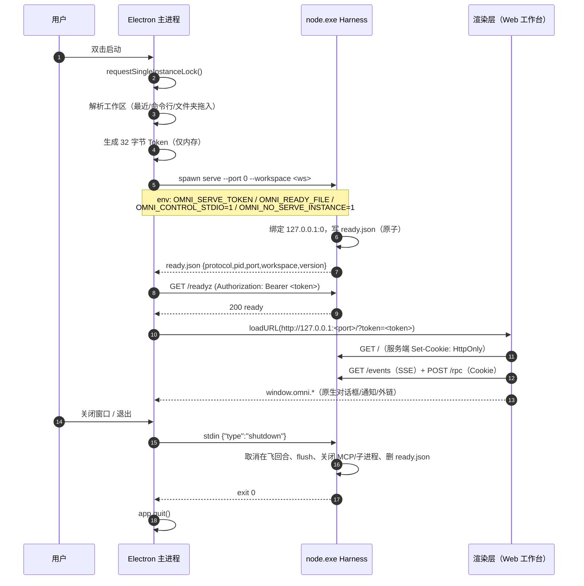

# OmniHarness 桌面应用技术方案与目标架构

> **状态**：提议稿（待架构评审）  
> **日期**：2026-10-24  
> **范围**：Windows 优先的桌面客户端；同时说明 macOS / Linux 的边界与后续路径  
> **结论先行**：**Electron 45 + 固定版本 Node 24 LTS 侧车（sidecar）+ 现有回环 HTTP/SSE 契约**。桌面壳只做生命周期与 OS 集成，不复制、不改写 Harness 业务逻辑；现有 Web 工作台与 CLI 继续作为同一服务的两个客户端。  
> **一句话架构**：`Electron 主进程（壳） → 预加载桥 → Chromium 渲染层（无 Node） → 回环 HTTP/SSE → Node 侧车（Harness） → N-API → Rust 内核`。

---

## 0. 摘要（TL;DR）

| 决策项         | 结论                                                                               | 理由（一句话）                                                                     |
| -------------- | ---------------------------------------------------------------------------------- | ---------------------------------------------------------------------------------- |
| 桌面壳         | **Electron 45.x**（Chromium 156 / Node 24.22）                                     | 与现有 Chrome 目标一致，OS 集成成熟，生态与自动更新链路完整                        |
| Harness 运行时 | **独立 `node.exe` 侧车，固定 Node 24.22 LTS**                                      | 保留 `process.execPath`、权限模型、插件 Worker 的既有语义；壳与 Harness 可独立升级 |
| 通信           | **继续用 `127.0.0.1:0` + Bearer Token + HttpOnly Cookie + SSE**                    | 不新增第二套业务 IPC；桌面、浏览器、CLI 共用同一契约                               |
| UI 交付        | **仍由 Harness 静态托管 `web/dist`，窗口 `loadURL` 回环地址**                      | 现有 `ServerAuthGuard` 只放行回环 Origin；`file://`/自定义协议会直接 401           |
| 进程模型       | 主进程 / 渲染进程 / Harness 进程 / Harness 的子进程                                | 崩溃隔离 + 最小权限；Harness 可脱离 Electron 独立运行                              |
| 安全基线       | 渲染层 sandbox + contextIsolation + 严格 IPC 白名单 + CSP + Fuses + ASAR 完整性    | Electron 官方安全清单的“生产档”                                                    |
| 打包           | `electron-builder` 26 + NSIS 按用户安装 + GitHub Releases 自动更新                 | Windows 差分更新、签名、灰度发布一条链                                             |
| 不做什么       | 不重写 Harness、不把 Node 塞进渲染层、不用 `file://` 载入 UI、不暴露 `ipcRenderer` | 任何一条都会把“桌面化”变成“第二套产品”                                             |
| 工期           | Windows 签名 Beta **6–8 周**（1–2 名工程师）；macOS 再加 4–6 周                    | 不含模型/产品新功能，只含桌面化与发布工程                                          |

**最重要的三个前置发现**（详见 §2.4、§6.7、附录 F）：

1. `src/plugin/worker/workerSpawnSpecBuilder.ts` 使用 `--experimental-permission`；该旗标在 **Node 24 / Electron 44 的 Node 24.21 上直接报 `bad option`**，而 `--permission` 在 Node 22.20、Node 24.22.1、Electron 44.7 上均可用。**桌面化前必须先改**，否则插件 Worker 在桌面运行时必然启动失败。
2. 本机实测 `native/omni_napi.node` 在 **Node 24.22.1** 与 **Electron 44.7.0（ELECTRON_RUN_AS_NODE）** 下均可加载并 `ping` 成功；Electron 的 `electron.exe` 导出 N-API 符号。原生内核不是桌面化的阻塞项，但**必须保持“侧车 = 真 node.exe”**，否则 `process.execPath` 语义会变。
3. 现有服务端 `ServerAuthGuard` 的 Origin 白名单**只允许回环 http(s)**；这决定了 UI **不能**改成 `file://` 或 `app://` 加载，否则所有 `/rpc`、`/events` 都会被 401。回环托管不是“临时方案”，而是当前鉴权模型的组成部分。

---

## 1. “最适合”的判定标准

“最佳技术方案”不是抽象的框架排名，而是在本项目约束下**总拥有成本最低**的方案。本文用六条标准排序：

| 权重 | 标准                   | 说明                                                                                                                  |
| ---: | ---------------------- | --------------------------------------------------------------------------------------------------------------------- |
|  30% | **现有资产复用**       | 约 15 万行核心 TS（本机统计 `src/**` 149,546 行，不含测试）、Vite/React 工作台、CLI、N-API 内核、SSE 事件流能否零重写 |
|  20% | **交付速度与风险**     | 能否在数周内做出可安装、可升级、可回滚的 Beta                                                                         |
|  20% | **安全与可加固性**     | 渲染层隔离、IPC 最小面、更新链签名、供应链完整性                                                                      |
|  15% | **桌面体验 / OS 集成** | 托盘、通知、深链、文件对话框、单实例、自动启动、窗口状态                                                              |
|  10% | **分发 / 体积 / 更新** | 安装包大小、差分更新、签名、灰度、企业部署                                                                            |
|   5% | **长期维护与生态**     | 版本节奏、社区、排障资料、团队熟悉度                                                                                  |

**非目标（明确不做）**：

- 不把 Harness 重写成 Rust/Go 以换取“更小的壳”；Harness 的价值在 TS 生态与既有能力，不在壳。
- 不为桌面端复制一套 RPC/状态管理；桌面只是同一服务的“带 OS 能力的客户端”。
- 不在 v1 支持 32 位 Windows（Electron 45 已移除 32 位构建）、Windows ARM64 原生内核、Linux 全功能。
- 不承诺“绿色便携版”：Harness 的会话/配置仍写 `~/.omniharness`，真正便携需要 `OMNI_HOME` 级别的改造（见 §6.10）。

---

## 2. 现状盘点：哪些能直接用，哪些会挡路

### 2.1 可复用资产（桌面化的最大筹码）

| 资产          | 现状                                                                                          | 桌面化复用方式                                               |
| ------------- | --------------------------------------------------------------------------------------------- | ------------------------------------------------------------ |
| Web 工作台    | Vite 6 + React 19，产物 `web/dist` 约 2.2 MB；标准 SPA；`base: './'`                          | **原样复用**，由 Harness 静态托管；窗口载入回环 URL          |
| HTTP/SSE 契约 | `POST /rpc`（JSON-RPC 2.0）+ `GET /events`（SSE）+ `/files` + `/healthz` + `/readyz`          | 原样复用；桌面只增加“启动/停止/健康检查”                     |
| 鉴权          | 回环默认生成临时 Token；首屏 `?token=` 换 HttpOnly Cookie；`ServerAuthGuard` 统一校验 HTTP/WS | 桌面生成 Token、经环境变量注入；不落盘                       |
| CLI           | `omniharness serve/exec/doctor/...` 已具备工作区、配置分层、单实例记录、端口冲突诊断          | 侧车直接跑 `serve`；诊断复用 `doctor`                        |
| 原生内核      | Windows N-API `.node`（`native/omni_napi.node`，约 10.9 MB）                                  | 侧车进程内加载；布局保持 `dist/src/native` 与 `native/` 同级 |
| 前端测试      | 真 Chrome、jsdom、a11y、响应式等大量判据                                                      | 桌面 E2E 复用 Playwright；渲染层仍是 Chromium                |
| 工作区信任    | `~/.omniharness/trust.json`、项目级配置信任闸                                                 | 桌面不绕过；打开新工作区时沿用现有信任流程                   |

### 2.2 现有进程/端口事实（直接决定桌面方案）

- `HttpServer` **默认只绑 `127.0.0.1`**，非回环必须配 Token（fail-closed）。
- `runHttpServe` 在回环且未显式配 Token 时**自动生成临时 Token**，并在首屏 `index.html` 响应里 `Set-Cookie: omni_serve_token=...; HttpOnly; SameSite=Strict`。
- `ServerAuthGuard.verify()` 接受三种凭据：`Authorization: Bearer`、`?token=`（SSE 用）、Cookie；同时检查 `Origin`，**只允许回环 http(s) 页面**。
- `--port 0` 可用：`HttpServer.start(0)` 返回系统分配的实际端口；本机 Node 24 实测 `serve --port 0 --mock` 正常打印带 Token 的 UI URL。
- `ServeInstance` 记录写在 `~/.omniharness/serve-<port>.pid`；`--port 0` 时 `sweep()` 用 `serve-0.pid`、`announce()` 用实际端口，**两者路径不一致**（见 §6.2 的前置修复）。
- `ServeShutdown` 只监听 `SIGINT`/`SIGTERM`；**Windows 上 Node 的 `child.kill()` 不是可捕获的优雅信号**，必须另加控制通道（见 §6.3）。

### 2.3 代码层面的桌面化“暗礁”

| 位置                                                                                                                   | 问题                                                                            | 影响                                                                                 | 方案                                                                                                                                           |
| ---------------------------------------------------------------------------------------------------------------------- | ------------------------------------------------------------------------------- | ------------------------------------------------------------------------------------ | ---------------------------------------------------------------------------------------------------------------------------------------------- |
| `src/plugin/worker/workerSpawnSpecBuilder.ts:48`                                                                       | 使用 `--experimental-permission`                                                | Node 24 / Electron 44 直接 `bad option`，插件 Worker 起不来                          | 改为 `--permission`（Node ≥22.13 已稳定），并加 Node 22/24 双版本判据                                                                          |
| `src/daemon/daemonController.ts:205`、`src/worker/windowsShim.ts:69`、`src/plugin/worker/workerSpawnSpecBuilder.ts:79` | 以 `process.execPath` 作为 Node 解释器                                          | 在 Electron 主进程/utilityProcess 中它是 `electron.exe`，会拉起第二个 App 或直接失败 | **侧车使用真 `node.exe`**，这些调用语义不变；若走 utilityProcess，则必须逐一改造                                                               |
| `src/cli/cliServerCmds.ts`（`runHttpServe`）                                                                           | 只把 UI URL 打到 stdout；**即使 Token 是外部注入的，也会把 `?token=` 原样打印** | 桌面解析 stdout 脆弱；Token 经日志泄漏                                               | 新增 `OMNI_READY_FILE` 机器可读就绪文件；Token 由桌面经 `OMNI_SERVE_TOKEN` 注入，并加 `OMNI_NO_UI_URL=1` 抑制带 Token 的横幅；日志再做脱敏兜底 |
| `src/cli/serveShutdown.ts`                                                                                             | 只认 POSIX 信号                                                                 | Windows 无法优雅停 Harness，可能丢最后一笔落盘/孤儿 MCP 子进程                       | 新增 stdin 控制通道 + 父进程 EOF 兜底 + 树杀兜底                                                                                               |
| `web/index.html:36`                                                                                                    | 主题初始化是内联 `<script>`                                                     | 严格 CSP 需要 `'unsafe-inline'` 或 hash                                              | 抽成 `web/public/theme-init.js` 外链，`script-src 'self'`                                                                                      |
| `web/src/ui/components/BrowserPane.tsx:40`、`ExternalLinkCards.tsx:38`                                                 | `window.open(..., '_blank')` / `target="_blank"`                                | Electron 默认会开新窗口，可能继承不期望的权限                                        | `setWindowOpenHandler` 统一分流：回环预览 → 受控子窗口；外部 http(s)/mailto → 系统浏览器                                                       |
| `web/index.html` 无 CSP                                                                                                | 任何注入都少一层防线                                                            | 桌面端必须补 header CSP（不要只靠 meta）                                             |
| `package.json` 依赖含前端库                                                                                            | `react-dom`/`katex`/`highlight.js` 等已打进 `web/dist`，服务端不需要            | 桌面 staging 原样安装会多带上百 MB                                                   | staging 用“服务端最小依赖清单”安装，剔除前端库                                                                                                 |
| `@huggingface/transformers` 的 `.cache`                                                                                | 本机 `node_modules` 内缓存达 **2.2 GB**                                         | 直接打包安装包灾难                                                                   | 排除 `.cache`；模型缓存指向 `%LOCALAPPDATA%`；ONNX 作为可选能力包                                                                              |

### 2.4 本机实测（2026-10-24，Windows 11 26300）

| 测试                                                              | 结果                                                            | 说明                                               |
| ----------------------------------------------------------------- | --------------------------------------------------------------- | -------------------------------------------------- |
| `node 24.22.1 dist/src/cli/exec.js --version`                     | ✅ `omniharness 0.1.0`                                          | Node 24 可跑构建产物                               |
| `node 24.22.1 ... serve --port 0 --mock`                          | ✅ 绑定随机端口并打印带 Token URL                               | `--port 0` + 临时 Token 可用                       |
| `node 24.22.1 -e "require('./native/omni_napi.node').call(ping)"` | ✅ `{"native":true,"ok":true,"pong":true}`                      | N-API ABI 在 Node 24 正常                          |
| `node 24.22.1 --experimental-permission`                          | ❌ `bad option`                                                 | 必须改 `--permission`                              |
| `node 24.22.1 --permission`                                       | ✅                                                              | 与 Node 22.20 一致                                 |
| `electron 44.7.0`（`ELECTRON_RUN_AS_NODE=1`）加载同一 `.node`     | ✅ `ping` 成功                                                  | Electron 的 Node 24.21 也导出 N-API 符号           |
| Electron 45 GUI 启动                                              | ⚠️ 本会话 DSH 沙箱内返回 `STATUS_BREAKPOINT`，未完成 GUI 级验证 | 列为 Phase 0 第一项，见 §7；**不把未验证当已验证** |
| `npm run test:fast`（Node 24）                                    | ⚠️ 受沙箱临时目录 `EPERM` 阻断，未得到有效结论                  | 必须在 CI/真实桌面补 Node 24 全量判据              |

> 结论：**Node 24 作为 Harness 运行时是“有条件的可行”**——核心启动、服务、原生内核均通过；但必须先修权限旗标，并用 CI 跑完整单测。若 Node 24 门禁失败，退回 Node 22.20 侧车是零代码改动的降级路径（见 §6.7）。

---

## 3. 候选技术调研

### 3.1 事实基线（截至 2026-10-24）

| 技术                            | 最新稳定                             | 运行时/WebView                                    | 与本项目的关键事实                                                              |
| ------------------------------- | ------------------------------------ | ------------------------------------------------- | ------------------------------------------------------------------------------- |
| **Electron**                    | **45.0.0**（2026-10-21）             | Chromium 156 / Node 24.22 / V8 15.6               | 自带 Chromium 与 Node；`utilityProcess` 提供 Node 子进程；Fuses/ASAR 完整性成熟 |
| **Tauri**                       | **2.12.x**（CLI 2.12.4，2026-10-21） | 系统 WebView2 / WKWebView / WebKitGTK + Rust Core | 壳小；Node 需作为 sidecar 打包；跨平台 WebView 差异由开发者承担                 |
| **Wails**                       | **v3.0.0-beta.34**（2026-10-20）     | 系统 WebView + Go Core                            | 仍是 beta；Go 生态与团队栈不匹配                                                |
| **NW.js**                       | 持续维护                             | Chromium + Node（渲染层可直接 Node）              | 安全模型落后于 Electron 的 sandbox/contextIsolation 实践                        |
| **Neutralino**                  | 2.x                                  | 系统 WebView + 轻量原生层                         | 无 Node；要跑 Harness 仍需 Node sidecar，API 生态弱                             |
| **PWA / 浏览器 App 模式**       | —                                    | 浏览器                                            | 无托盘/深链/自动更新/文件对话框/单实例，不能算桌面应用                          |
| **原生重写（Rust/Qt/Flutter）** | —                                    | 原生                                              | UI 与 Harness 全重写，成本与风险不可接受                                        |

权威版本与能力来源见 [1]–[13]。Electron 45 的发布说明明确：Chromium 156、Node 24.22.0；同时提醒 45 起 **sandboxed preload 不再提供 `Buffer`/`setImmediate`/`events`/`timers`/`url` 垫片**——这直接影响 preload 写法（我们只暴露最小桥，不受影响，但必须知道）。

### 3.2 社区与生产实践信号

- Electron 官方 Showcase 里，VS Code、Slack、Discord、Obsidian、Postman、Signal、1Password 等长期生产应用在列 [19]。这说明“Electron 做大型本地优先工具”不是实验路线。
- 从公开工程形态看，AI/Agent 类桌面客户端常见两种：**Electron 壳 + Node 能力**，或 **Tauri 壳 + Node 侧车**。本项目属于前者更自然的形态——核心是 Node/TS 的 Agent 循环 + 本地文件/进程能力 + 复杂 Web UI，而不是“一个轻量表单”。
- Tauri 的官方 Node sidecar 指南明确建议用 `pkg`/打包器把 Node 应用变成二进制再作为 sidecar [11]；它并没有消除 Node 运行时，只是把 Node 藏到 sidecar 里。对本项目而言，这会变成 **Electron 等价的两个运行时 + 两套 IPC**，但少了 Electron 的 Chromium 一致性。
- Wails v3 仍是 beta（beta.34），且要求 Go 1.26+；对一个以 TS 为主仓的团队，引入 Go 壳的维护成本高于收益 [13]。

### 3.3 关键能力对照

| 能力                     | Electron 45                       | Tauri 2.12                               | Wails v3 beta                |
| ------------------------ | --------------------------------- | ---------------------------------------- | ---------------------------- |
| 复用现有 React UI        | ✅ 同一 Chromium                  | ⚠️ WebView2/WKWebView/WebKitGTK 三套内核 | ⚠️ 同上                      |
| 复用 Node Harness        | ✅ 内置 Node 或侧车               | ❌ 必须 sidecar                          | ❌ 必须 sidecar              |
| 托盘/通知/深链/单实例    | ✅ 成熟                           | ✅ 插件齐全                              | ✅ 基本齐全                  |
| 自动更新（Windows 差分） | ✅ electron-updater + NSIS        | ✅ 官方 updater（需签名）                | ✅ 自带 updater              |
| 安装包体积               | ⚠️ 大（Chromium）                 | ✅ 小（系统 WebView）                    | ✅ 小                        |
| 渲染层安全模型           | ✅ sandbox/contextIsolation/fuses | ✅ 能力白名单（Rust 侧）                 | ⚠️ 相对年轻                  |
| 跨平台 UI 一致性         | ✅ 最高                           | ⚠️ 需逐平台测试                          | ⚠️ 需逐平台测试              |
| 与本项目技术栈匹配       | ✅ TS/Node 原生                   | ⚠️ 引入 Rust 壳 + Node sidecar           | ❌ 引入 Go 壳 + Node sidecar |
| 生产案例密度（桌面工具） | ✅ 极高                           | ⚠️ 增长中                                | ⚠️ 较少                      |

### 3.4 体积/内存的现实预期

不要用“Electron 一定臃肿、Tauri 一定轻”的口号做决策；要按本项目拆分：

| 组成                                                  |      安装后估算 |      压缩后估算 | 说明                                                |
| ----------------------------------------------------- | --------------: | --------------: | --------------------------------------------------- |
| Electron 运行时（Chromium+Node）                      |     ~300–370 MB |     ~100–120 MB | 本机 Electron 44.7 `dist` 实测 367.7 MB             |
| Node 24 侧车 `node.exe`                               |          ~90 MB |          ~30 MB | 本机 Node 24.22.1 实测 89.6 MB                      |
| Harness 产物（`dist`+`web/dist`+`defaults`+`native`） |          ~35 MB |          ~12 MB | `dist` 19.7 MB、`web/dist` 2.2 MB、`native` 10.9 MB |
| 服务端生产依赖（裁剪后）                              |       ~30–50 MB |       ~10–15 MB | 剔除 React/KaTeX/highlight 等前端库                 |
| **基础版合计**                                        | **~450–550 MB** | **~150–180 MB** | 估算；Phase 0 用真实 `electron-builder` 产物校准    |
| 可选 ONNX/本地嵌入包                                  |     +65 MB/平台 |          +25 MB | `onnxruntime-node` 全平台 210 MB；按平台裁剪        |
| 模型权重                                              |   0（按需下载） |               0 | 默认缓存到 `%LOCALAPPDATA%`，绝不进安装包           |

**判断**：对“本地 Agent 工作台”这个品类，150–180 MB 的安装包与 300–550 MB 常驻内存是可接受的；把安装包压到 80 MB 以下而引入第二套 IPC/三套 WebView，是拿核心稳定性换一个非核心指标。

### 3.5 可借鉴的开源工程模式

| 项目/模式                    | 公开事实                                                       | 可借鉴                                                                | 不照搬                                                                                 |
| ---------------------------- | -------------------------------------------------------------- | --------------------------------------------------------------------- | -------------------------------------------------------------------------------------- |
| **VS Code**                  | Electron 壳 + 独立 Extension Host 进程；扩展崩溃不带走 UI [21] | “能力进程与 UI 进程分离”的边界设计；本项目的 Harness 侧车就是同一思路 | 它的 Extension Host 是 Node 进程、用私有 IPC；我们继续用 HTTP/SSE，便于 CLI/浏览器复用 |
| **GitHub Desktop**           | Electron + 本地 Git 子进程；安装器/自动更新成熟 [22]           | 本地工具型 App 的窗口/更新/日志工程化                                 | 不引入它的 Git 领域模型；本项目的工具执行已在 Harness 内                               |
| **Signal Desktop**           | Electron + 本地 SQLite；长期生产、重安全加固 [23]              | 本地数据、签名发布、更新链的长期维护经验                              | 不做端到端加密通信；本项目是本地单用户工作台                                           |
| **Tauri Node sidecar**       | 官方指南把 Node 应用打成二进制作 sidecar [11]                  | “Node 作为独立进程”是跨壳可复用的模式                                 | 不为了小壳引入三套 WebView/两套 IPC                                                    |
| **Electron 官方安全/ Fuses** | 官方清单 + 打包期 fuse + ASAR 完整性 [3][4][6]                 | 生产档安全基线直接照做                                                | 不因为“本地应用”就跳过 CSP/sandbox                                                     |

**结论**：开源社区的主流做法不是“把 Node 塞进渲染层”，而是**把能力放进独立进程、把 UI 留在沙箱里**。这与本项目的 Harness 侧车方案同向；真正需要自己设计的是“壳 ↔ 服务”的契约与生命周期，而不是重复造一个 Electron/Tauri 内核。

---

## 4. 决策矩阵与结论

### 4.1 加权评分（1–5 分，工程判断，不是 benchmark）

权重见 §1。分数用于**暴露取舍**，不追求伪精确。

| 方案                             | 资产复用 30% | 交付速度 20% | 安全 20% | OS 体验 15% | 分发/体积 10% | 维护 5% | 加权分 |
| -------------------------------- | -----------: | -----------: | -------: | ----------: | ------------: | ------: | -----: |
| **Electron + Node 侧车（推荐）** |            5 |            4 |        4 |           5 |             3 |       5 | **88** |
| Electron + `utilityProcess`      |            5 |            3 |        3 |           5 |             5 |       5 | **84** |
| Tauri 2 + Node 侧车              |            4 |            3 |        5 |           4 |             4 |       4 | **80** |
| PWA + 本地服务                   |            4 |            4 |        3 |           1 |             5 |       4 | **69** |
| Wails v3 + Node 侧车             |            4 |            2 |        4 |           3 |             3 |       2 | **65** |
| NW.js                            |            4 |            3 |        1 |           3 |             2 |       2 | **55** |
| 原生重写                         |            1 |            1 |        5 |           4 |             3 |       2 | **50** |

### 4.2 为什么是 Electron + 侧车，而不是 Tauri

Tauri 在“壳的体积/内存/默认权限”上确实更好；但它要求：

1. **Node 仍要打包**（sidecar），所以省掉的只是 Chromium，不是整个运行时；
2. **UI 要跑在三套 WebView 上**（WebView2/WKWebView/WebKitGTK），本项目的复杂 CSS、KaTeX、虚拟滚动、SSE、预览 iframe 都要逐平台回归；
3. **要维护两套 IPC**：Tauri command 用于 OS 能力，HTTP/SSE 用于 Harness；错误边界、鉴权、调试链路都翻倍；
4. **团队栈不匹配**：壳层用 Rust，出问题时要同时懂 Rust/Tauri 与 TS Harness。

反过来说，Tauri 的收益（安装包少约 100 MB、内存少约 100–200 MB）在本项目“Harness 本身就可能占数百 MB”的背景下，不足以抵消上述成本。**结论：v1 不做 Tauri；把“壳可替换”作为架构约束保留（见 §5.2），当安装包/内存成为硬性商业约束，或 Harness 核心迁到 Rust 时再评估。**

### 4.3 为什么不是 Electron `utilityProcess`

`utilityProcess` 是 Electron 官方推荐的“Node 子进程”方式，省掉一个 `node.exe`（约 30 MB 压缩），并且生命周期由 Electron 管理。但对本项目有两个硬伤：

1. **`process.execPath` 语义变化**：`utilityProcess` 里 `process.execPath` 仍是 `electron.exe`，而 Harness 有多处用它当 Node 解释器（守护进程、插件 Worker、Windows `.cmd` 垫片、boost 脚本）。改成 `utilityProcess` 需要逐个改造成 `execArgv`/`ELECTRON_RUN_AS_NODE`，并处理 `runAsNode` fuse 的冲突。
2. **安全 fuse 冲突**：生产档要关 `runAsNode`，而 `child_process.fork`/`ELECTRON_RUN_AS_NODE` 依赖它；关了就必须把所有“起 Node 子进程”的路径改成 utilityProcess。改动面从“桌面壳”扩散到“插件安全/守护进程”核心代码。

侧车方案把这两个问题一次性消掉：**`process.execPath` 就是 `node.exe`，所有既有语义原样成立**；同时可以关掉 `runAsNode`，让 Electron 壳更硬。代价只是多 30 MB 压缩体积。**这是“用体积换正确性”的典型划算交易。**

> 保留 `utilityProcess` 作为备选：若未来安装包体积成为硬约束，且愿意做上述改造，可按 §10 的迁移路径切换；HTTP 契约不变，壳代码大部分可复用。

---

## 5. 目标架构

### 5.1 架构原则（铁律）

1. **壳不做业务**：Electron 主进程只负责窗口、生命周期、OS 集成、更新；不 import `src/core`、不直接读写会话。
2. **一个契约，三个客户端**：桌面、Web、CLI 都通过同一 HTTP/SSE 契约访问 Harness；桌面不是“特权分支”。
3. **进程隔离优先于进程内方便**：Harness 崩溃不能带走窗口；渲染层被攻破不能碰 Node。
4. **默认拒绝**：渲染导航、窗口打开、权限请求、IPC 通道、更新源全部白名单。
5. **运行时版本是打包选择，不是架构锁**：Harness 侧车可独立固定 Node 版本；壳可独立升级 Electron。
6. **打包是架构的一部分**：体积、签名、ASAR 完整性、更新回滚在第一天就纳入设计。
7. **每个集成点都有可测契约**：就绪文件、控制通道、桥 API、版本握手都要有单测/集成测。

### 5.2 进程与信任边界

```text
┌────────────────────────────── 用户会话（Windows） ──────────────────────────────┐
│                                                                                │
│  Electron 主进程（受信，但无业务逻辑）                                          │
│   ├─ BrowserWindow / WebContents（Chromium sandbox，nodeIntegration=false）     │
│   │    └─ preload（isolated world，只暴露 window.omni 最小桥）                  │
│   ├─ HarnessSupervisor（spawn / ready / health / stop / restart）               │
│   ├─ Updater / Tray / Menu / Notifications / DeepLink / Dialogs                 │
│   └─ 本地日志 / 诊断导出 / 窗口状态                                             │
│                                                                                │
│  node.exe 侧车（Harness，独立进程，独立崩溃域）                                 │
│   ├─ HTTP/SSE 服务：127.0.0.1:<随机端口>，Bearer + HttpOnly Cookie              │
│   ├─ Agent 循环 / 工具 / 审批 / 沙箱 / MCP / 会话存档                           │
│   ├─ N-API → native/omni_napi.node（Rust 内核，Windows）                        │
│   └─ 子进程：MCP 网关 / shell 后台任务 / 插件 Worker（各自沙箱/权限）            │
│                                                                                │
│  渲染层 →（HTTP/SSE，带 Cookie）→ Harness；渲染层 →（IPC）→ 主进程 → OS          │
│  渲染层 ✗→ Node / fs / child_process；主进程 ✗→ Harness 内部状态                 │
└────────────────────────────────────────────────────────────────────────────────┘
```

**信任边界**：

- **渲染层不可信**：它渲染模型输出/工作区内容，必须假设可能被 XSS。
- **preload 是窄腰**：只暴露 `window.omni`，参数经主进程校验；不暴露 `ipcRenderer`、`require`、`process`。
- **主进程受信但克制**：只做“用户明确要求的 OS 操作”，不提供任意路径/任意命令执行。
- **Harness 是能力中心**：所有工具执行仍走既有审批/沙箱门禁；桌面不额外提权。

### 5.3 启动时序



### 5.4 目录与模块

桌面代码**不要放进 `src/`**（否则会破坏现有六边形架构门禁与发布包边界），而是作为独立的 `desktop/` 包：

```text
desktop/
  package.json                 # 独立依赖：electron / electron-builder / esbuild；不发布到 npm
  tsconfig.json                # 只做类型检查
  src/
    main/
      main.ts                  # app 生命周期、单实例、协议注册
      window.ts                # BrowserWindow 工厂、窗口状态、缩放
      harness/
        supervisor.ts          # 状态机：spawn/ready/health/stop/restart
        readyContract.ts       # ready.json 的 zod schema + 校验
        nodeRuntime.ts         # 定位 node.exe（打包/开发）
        env.ts                 # 环境变量白名单与清洗
        logs.ts                # stdout/stderr 分流、轮转、脱敏、环形缓冲
        killTree.ts            # Windows taskkill / POSIX 进程组
      ipc/
        channels.ts            # 通道名常量（唯一来源）
        validate.ts            # sender / origin / 参数校验
        handlers.ts            # 所有 ipcMain.handle
      security/
        webPreferences.ts      # 统一安全 webPreferences
        navigation.ts          # will-navigate / setWindowOpenHandler / web-contents-created
        permissions.ts         # 权限请求白名单
        csp.ts                 # onHeadersReceived 注入 CSP
      os/
        tray.ts                # 托盘与菜单
        notifications.ts       # 通知与点击聚焦
        dialogs.ts             # 工作区/文件选择
        deepLink.ts            # omniharness:// 解析与单实例转发
        loginItem.ts           # 开机启动
      update/
        updater.ts             # electron-updater 封装、渠道、灰度、退出前清理
      state/
        desktopState.ts        # 最近工作区/窗口/偏好（原子写）
      diagnostics.ts           # 导出日志/版本/doctor 摘要
    preload/
      preload.ts               # 只 import electron；contextBridge.exposeInMainWorld
    shared/
      desktopApi.ts            # 桥 API 类型（不依赖 electron/node）
      errors.ts                # 错误码与用户文案
  build/
    icon.ico / icon.icns / icon.png
    installer.nsh
    entitlements.mac.plist
  test/
    supervisor.test.ts
    readyContract.test.ts
    ipcValidate.test.ts
    e2e/                       # Playwright _electron
  electron-builder.yml
```

**前端只加一层“桌面宿主端口”**：

```text
web/src/core/desktop/
  DesktopBridge.ts        # interface：桌面能力（浏览器下为 null 实现）
  NullDesktopBridge.ts    # 浏览器/CLI 托管时全部 no-op
  ElectronDesktopBridge.ts# 读 window.omni，做能力检测与错误映射
```

UI 里**不出现 `window.omni` 的直接调用**（除这个适配器），便于在浏览器/测试中运行。

**Harness 只加两个 CLI 适配器**（不动 core/ports）：

```text
src/cli/serveReadyFile.ts   # OMNI_READY_FILE：绑定成功后原子写、退出时删
src/cli/serveControl.ts     # OMNI_CONTROL_STDIO：stdin JSON lines → 优雅 shutdown
```

依赖方向：

```text
desktop/main  → desktop/shared, electron, node:*
desktop/preload → electron（仅 contextBridge/ipcRenderer/webUtils）
desktop/shared → 纯类型，无 electron/node
web/src        → 不 import electron；只通过 DesktopBridge 接口
src/**         → 不 import desktop/**；不 import electron
```

**架构门禁建议**：在现有 `scripts/architectureGate.mjs` 增加两条文本判据：

- `src/**` 与 `web/src/**` 不得出现 `from 'electron'`（`desktop/` 与测试除外）；
- `src/**` 不得出现 `desktop/` 相对导入。

### 5.5 状态归属（唯一真相源）

| 状态          | 位置                                                 | 写入者           | 备注                                                    |
| ------------- | ---------------------------------------------------- | ---------------- | ------------------------------------------------------- |
| 会话事件流    | `~/.omniharness/sessions/*.jsonl`                    | Harness          | 全局；CLI/桌面共享；不要搬到 `userData`                 |
| 用户配置      | `~/.omniharness/omniharness.json`                    | Harness/UI       | 现有分层；桌面不另存一份                                |
| 凭据          | `~/.omniharness/vault.key` / 现有 vault              | Harness          | 桌面不存 API Key                                        |
| 工作区状态    | `<ws>/.omniharness/**`                               | Harness          | 信任、图、任务、日志                                    |
| 桌面偏好      | `%APPDATA%\OmniHarness\desktop.json`                 | 主进程           | 最近工作区、窗口、开关                                  |
| Shell 日志    | `%LOCALAPPDATA%\OmniHarness\logs`                    | 主进程           | 轮转；脱敏                                              |
| Harness 日志  | 同上 `harness-*.log`                                 | 主进程代写       | 来自侧车 stdout/stderr                                  |
| 就绪文件      | `%LOCALAPPDATA%\OmniHarness\run`                     | Harness          | 每次启动唯一；退出删除                                  |
| 更新缓存      | `%LOCALAPPDATA%\OmniHarness\updater`                 | electron-updater | 可清理                                                  |
| 模型/向量缓存 | `%LOCALAPPDATA%\OmniHarness\models`、`...\vec-cache` | Harness          | 通过 `OMNI_EMBEDDING_CACHE_DIR` / `OMNI_VEC_CACHE` 指定 |

> **为什么不用 `electron-store`/SQLite 存桌面偏好**：偏好是小而稳定的 JSON；仓库已有“原子写 + 结构校验”的纪律，自己写 60 行比引入依赖更可控。

---

## 6. 关键技术方案

### 6.1 UI 交付：回环托管，不做 `file://` / 自定义协议

**决策**：窗口 `loadURL('http://127.0.0.1:<port>/?token=<token>')`，由现有 Harness 静态托管 `web/dist`。

**理由**：

- `ServerAuthGuard.originAllowed()` 只接受回环 http(s) Origin；`file://` 的 Origin 是 `null`，自定义 `app://` 也不在白名单 → `/rpc`、`/events` 全部 401。
- 回环托管让 **Cookie/SSE/CORS/相对路径**全部保持浏览器语义，零改动。
- 桌面与浏览器共用同一产物与同一套前端测试；不会出现“桌面版才能复现”的布局/路由差异。

**Token 生命周期**：

1. 主进程生成 `randomBytes(32).toString('hex')`，经 `OMNI_SERVE_TOKEN` 注入侧车，**不写文件、不进日志**。
2. 首屏 URL 带 `?token=`；服务端 `index.html` 响应设置 `HttpOnly; SameSite=Strict` Cookie。
3. 页面加载完成后执行 `history.replaceState({}, '', '/')` 去掉地址栏 Token；后续 RPC/SSE 依靠 Cookie（以及前端 `authToken` 从 URL 读到的 Token 发 Bearer，二者都可用）。
4. 刷新窗口时 Cookie 仍有效；Harness 重启换 Token 时，主进程用新 URL 重新 `loadURL`，新 `Set-Cookie` 覆盖旧值。
5. **不把 Token 写入 `localStorage`**；现有 `authToken` 的 localStorage 分支保留给浏览器场景，桌面不调用 `set()` 持久化。
6. **抑制服务端横幅**：`runHttpServe` 目前无条件打印带 `?token=` 的 UI URL；桌面模式必须加 `OMNI_NO_UI_URL=1`（或让主进程对 stdout 做 `token=` 脱敏）。否则 Token 会经侧车 stdout 落进桌面日志——这是“Token 不落盘”之外同样重要的泄漏面。

**CSP**（由主进程 `session.webRequest.onHeadersReceived` 注入，同时建议服务端也下发）：

```text
default-src 'none';
script-src 'self';
style-src 'self' 'unsafe-inline';
img-src 'self' data: blob:;
font-src 'self' data:;
connect-src 'self' http://127.0.0.1:<harnessPort> ws://127.0.0.1:<harnessPort>;
frame-src 'self' http://127.0.0.1:<previewPort>;
media-src 'self' blob:;
base-uri 'none';
form-action 'none';
object-src 'none';
frame-ancestors 'none';
```

说明：

- `connect-src` 用**实际监听端口**，不要写成 `http://127.0.0.1:*`；后者等于允许渲染层探测本机任意回环服务。
- `frame-src` 用 `/healthz` 返回的 `previewPort`（预览独立回环端口）；预览未启用/启动失败时设为 `'none'`。不要长期用 `127.0.0.1:*` 放宽。
- `style-src 'unsafe-inline'` 是现有 React 内联样式/面板宽度拖拽所需；不要顺手去掉。
- `img-src` 默认不含 `https:`：若产品要显示模型输出里的远程图片，需显式加 `https:` 或走服务端代理；这是隐私/可用性取舍，建议默认阻止并在设置里提供开关。
- 把 `web/index.html` 的内联主题脚本抽成 `web/public/theme-init.js`，才能保持 `script-src 'self'`；否则只能加 `'unsafe-inline'`，不建议。

### 6.2 就绪契约：机器可读，不解析 stdout

新增环境变量 `OMNI_READY_FILE`；`runHttpServe` 在**绑定成功、拿到实际端口之后**原子写入：

```json
{
  "protocol": 1,
  "pid": 12345,
  "host": "127.0.0.1",
  "port": 51234,
  "workspace": "D:\\work\\demo",
  "harnessVersion": "0.2.0",
  "apiVersion": "0.1.0",
  "startedAt": "2026-10-24T13:40:32.058Z"
}
```

规则：

- **Token 不写入**（桌面用 `OMNI_SERVE_TOKEN` 注入；CLI 若要写可另加可选字段，但桌面模式不需要）。
- 先写 `*.tmp` 再 `rename`，读者永远看不到半截 JSON；权限 `0600`（Windows 走用户目录 ACL）。
- 退出/被优雅关闭时删除；异常退出留下的文件由主进程按 `pid` 判活后清理。
- `protocol` 是壳/侧车握手版本；`apiVersion` 是 `src/version.ts` 的公开 API 版本；`harnessVersion` 是包版本。三者独立，不要混用。
- 主进程等待策略：50 ms 轮询 + 30 s 超时；校验 `pid` 存活、`workspace` 非空、`port` 在 1–65535；随后 `GET /readyz`（带 Bearer）确认应用就绪，而不是只看端口。

**前置修复（P0）**：`--port 0` 时 `ServeInstance.sweep(pathFor(0))` 与 `announce({port: 实际端口})` 路径不一致。桌面模式建议加 `OMNI_NO_SERVE_INSTANCE=1` 完全跳过 `serve-*.pid`（桌面有自己的单实例与 ready 文件）；若保留，则改成“绑定后再 sweep 实际端口”。

### 6.3 生命周期与优雅退出

**问题**：Windows 上 `child.kill('SIGTERM')` 等价于强制终止，`ServeShutdown` 收不到可捕获信号；直接杀会丢最后一笔落盘，MCP 网关/后台 shell 可能变孤儿进程。

**方案**：stdin 控制通道 + 父进程 EOF 兜底。

`serveControl.ts`（仅当 `OMNI_CONTROL_STDIO=1`）：

```ts
process.stdin.setEncoding('utf8');
process.stdin.resume();
let buffer = '';
process.stdin.on('data', (chunk) => {
  buffer += chunk;
  let index;
  while ((index = buffer.indexOf('\n')) >= 0) {
    const line = buffer.slice(0, index).trim();
    buffer = buffer.slice(index + 1);
    if (line === '') continue;
    try {
      const message = JSON.parse(line) as { type?: string };
      if (message.type === 'shutdown') shutdown('control');
    } catch {
      // 忽略坏行；控制通道只接受父进程，不对外暴露
    }
  }
});
process.stdin.on('end', () => shutdown('stdin-eof'));
```

`shutdown` 复用 `ServeShutdown` 的同一收尾顺序：**先取消在飞回合并等待落盘 → 关 MCP 网关/子进程 → 关 HTTP → 删 ready/实例记录 → resolve(0)**。`ServeShutdown.wait` 增加可选的 `control` 参数，避免复制逻辑。

**主进程停止流程**：

```text
write {"type":"shutdown"}\n
→ child.stdin.end()
→ 等 exit（10 s）
→ child.kill()（2 s）
→ taskkill /PID <pid> /T /F（Windows 兜底）/ process.kill(-pid, 'SIGKILL')（POSIX 进程组）
→ 清理 ready 文件
```

**崩溃恢复**：

- 侧车意外退出 → 记录退出码/最后 200 行日志 → 指数退避重启（1 s / 2 s / 5 s，最多 3 次）→ 仍失败则显示“Harness 无法启动”面板（重试 / 打开日志 / 退出）。
- 健康检查：每 10 s `GET /healthz`；连续 3 次失败视为失联，走重启。
- 渲染层崩溃：`render-process-gone` → 自动 `reload()` 一次；再次崩溃显示错误页。
- 重启后端口/Token 都会变：主进程用新 URL 重新加载，保留原路由（hash/query）以便回到同一会话。

### 6.4 单实例、工作区与深链

**单实例**：

```ts
if (!app.requestSingleInstanceLock()) {
  app.quit();
  return;
}
app.on('second-instance', (_event, argv) => {
  const target = parseLaunchTarget(argv); // 文件夹 / omniharness://
  focusMainWindow();
  if (target) queueLaunchTarget(target);
});
```

**工作区解析顺序**（桌面自己的规则，明确优先于 Harness 的 `serveWorkspace` 回退）：

1. 命令行 `--workspace <path>` 或拖入的文件夹；
2. 上次成功打开的工作区（`desktop.json`）；
3. 本机固定项目 `~/.omniharness/omniharness.json` 的 `workspace`；
4. 首次启动：原生目录选择框（默认 `Documents`）；取消则退出（v1 不做欢迎页，减少一条未验证的 UI 路径）。

**必须显式传 `--workspace`**：从开始菜单/快捷方式启动时，进程 cwd 可能是 `C:\Windows\System32`，绝不能靠 cwd 推断工作区。侧车 `cwd` 也设为该工作区，保证工具的相对路径行为一致。

**深链**：`omniharness://open?workspace=<urlencoded>&session=<id>`

- 打包后 `app.setAsDefaultProtocolClient('omniharness')`；开发态带 `process.execPath` + 入口参数。
- 解析后只接受：`workspace` 是已存在目录、`session` 是安全 id；**不执行任何 URL 里的命令/提示词**。
- 未运行时先入队，等 Harness ready + 渲染层 `did-finish-load` 后再转发 `omni.onDeepLink`。
- 未知工作区先弹确认（“打开并信任此文件夹？”），不自动信任。

**拖拽文件夹**：渲染层 `drop` → `webUtils.getPathForFile(file)`（Electron 32 起 `File.path` 已移除）→ `omni.openWorkspace(path)`；主进程做存在性/目录校验后再切换。该 API 需在 Phase 0 实测 sandboxed preload 下的行为。

### 6.5 托盘、通知、后台任务

**托盘**：

- 图标三态：idle / running / error；`omni.setActivity()` 由 UI 在回合开始/结束/失败时上报（主进程不猜）。
- 菜单：显示窗口、新建会话、打开工作区、检查更新、打开日志、退出。
- 关闭行为：设置项 `closeToTray`（默认 **开**，因为 Agent 任务可能很长）；关闭时若 `isQuitting=false` 则 `event.preventDefault()` + `hide()`，首次隐藏弹一次系统通知“仍在后台运行”。
- 托盘“退出”走 §6.3 的优雅停止；`before-quit` 期间禁止窗口 close 拦截。

**通知**：

- 渲染层在回合完成/需要审批时调用 `omni.notify({title, body, sessionId, kind})`；主进程用 `new Notification(...)` 展示。
- 窗口聚焦时不弹（避免打扰）；通知点击 → `show()+focus()` → `omni.onNotificationClick(sessionId)` → UI 路由到会话/审批卡。
- 默认不把提示词/文件内容放进通知正文（隐私）；只放“会话标题 + 状态”。
- Windows 需 `app.setAppUserModelId('com.mylong227.omniharness')`，且安装器快捷方式的 AUMID 要一致，否则 Toast 不显示/不聚合。

**后台任务**：

- 窗口隐藏不等于 Harness 停止；侧车继续跑。
- `powerSaveBlocker` 仅在“有回合在跑且用户设置允许”时启用，任务结束释放；不要常驻阻止睡眠。
- 开机启动默认关；开启时 `--hidden` 启动到托盘，不抢焦点。

### 6.6 安全加固（生产档）

**渲染层 `webPreferences`（唯一工厂，禁止各处手写）**：

```ts
const securePreferences: WebPreferences = {
  sandbox: true,
  contextIsolation: true,
  nodeIntegration: false,
  nodeIntegrationInWorker: false,
  nodeIntegrationInSubFrames: false,
  webviewTag: false,
  webSecurity: true,
  allowRunningInsecureContent: false,
  experimentalFeatures: false,
  spellcheck: false,
  backgroundThrottling: false,
  preload: path.join(__dirname, 'preload.cjs'),
};
```

**导航与窗口打开**：

```ts
app.on('web-contents-created', (_event, contents) => {
  contents.on('will-navigate', (event, url) => {
    if (!isHarnessUrl(url)) {
      event.preventDefault();
      void openExternalSafely(url);
    }
  });
  contents.setWindowOpenHandler(({ url }) => {
    if (isPreviewUrl(url))
      return { action: 'allow', overrideBrowserWindowOptions: previewWindowOptions };
    void openExternalSafely(url);
    return { action: 'deny' };
  });
  contents.on('will-attach-webview', (event) => event.preventDefault());
});
```

- `openExternalSafely` 只允许 `http:`/`https:`/`mailto:`；拒绝 `file:`、`javascript:`、`data:`、`smb:`、`ms-*:`。
- 预览子窗口：`sandbox:true`、无 preload、`nodeIntegration:false`，并套用同一套导航/权限守卫。
- 外部链接一律交给系统浏览器；**不在主窗口内嵌任意远程页面**。

**权限**：

```ts
session.defaultSession.setPermissionRequestHandler((wc, permission, callback) => {
  const url = new URL(wc.getURL());
  const trusted = url.hostname === '127.0.0.1' && url.port === String(harnessPort);
  callback(
    trusted && (permission === 'notifications' || permission === 'clipboard-sanitized-write'),
  );
});
session.defaultSession.setPermissionCheckHandler((_wc, permission, requestingOrigin) => {
  return (
    requestingOrigin === `http://127.0.0.1:${harnessPort}` &&
    (permission === 'notifications' || permission === 'clipboard-sanitized-write')
  );
});
```

其余（摄像头、麦克风、地理位置、HID、串口、MIDI、剪贴板读）一律拒绝；需要时再逐项评审。

**Fuses（生产构建）**：

```yaml
electronFuses:
  runAsNode: false
  enableCookieEncryption: true
  enableNodeOptionsEnvironmentVariable: false
  enableNodeCliInspectArguments: false
  enableEmbeddedAsarIntegrityValidation: true
  onlyLoadAppFromAsar: true
  grantFileProtocolExtraPrivileges: false
```

- 侧车是独立 `node.exe`，不受 `runAsNode` 影响；这是侧车方案的又一好处。
- `enableNodeCliInspectArguments:false` 会让 Playwright Electron 无法连接（其已知限制要求该 fuse 不为 false）[17]；因此 **E2E 跑未翻 fuse 的开发构建**，发布构建另做安装/启动烟测。
- `onlyLoadAppFromAsar` + `enableEmbeddedAsarIntegrityValidation` 要求 `asar.disableIntegrity` 不为 true；electron-builder 26 支持 `electronFuses` 并在签名前翻 fuse [9]。

**环境变量清洗（容易被忽略）**：

侧车是 `node.exe`，会读取 `NODE_OPTIONS`、`NODE_PATH`、`NODE_EXTRA_CA_CERTS`；即使 Electron 关了 `nodeOptions` fuse，也管不到侧车。主进程必须：

```ts
const env = { ...process.env };
for (const key of [
  'NODE_OPTIONS',
  'NODE_PATH',
  'NODE_EXTRA_CA_CERTS',
  'ELECTRON_RUN_AS_NODE',
  'ELECTRON_NO_ASAR',
]) {
  delete env[key];
}
// 仅保留受控的 OMNI_* 与已知 provider key；不要整包透传
```

Provider Key 是否透传要显式列白名单（`OPENAI_API_KEY`、`ANTHROPIC_API_KEY`、`DEEPSEEK_API_KEY` 等），否则用户“在系统环境变量里配了 Key”会突然失效；这是产品行为，要在设置里说明。

**IPC 校验（每个 handler 第一行）**：

```ts
function assertTrustedSender(event: IpcMainInvokeEvent): void {
  if (event.sender !== mainWindow?.webContents) throw denied();
  const frame = event.senderFrame;
  if (!frame || frame.parent !== null) throw denied();
  const url = new URL(frame.url);
  if (
    url.protocol !== 'http:' ||
    url.hostname !== '127.0.0.1' ||
    url.port !== String(harnessPort)
  ) {
    throw denied();
  }
}
```

- 参数用 zod/手写 schema 校验；路径必须 `resolve` 后做“是否在工作区内/是否用户刚选择”的判定。
- 不提供 `exec`/`spawn`/`readFile(any)` 这类通用能力；桥 API 是**语义化**的（`pickWorkspace`、`revealPath`、`openExternal`）。
- 不暴露 `ipcRenderer`；preload 只导出冻结对象。

**其他**：

- **收紧 Origin/Host**：`ServerAuthGuard` 现在只校验“Origin 是任意回环 http(s)”，并未绑定本次监听端口，也不校验 `Host`。建议桌面模式把它收紧为精确的 `http://127.0.0.1:<harnessPort>`（预览/开发另列白名单），并校验 `Host` 为 `127.0.0.1:<port>` / `localhost:<port>`；这是对 DNS rebinding/本机多服务误用的额外一道门，属于 P1 加固项。
- **ASAR 完整性的边界**：`enableEmbeddedAsarIntegrityValidation` 只保护 `app.asar`（壳代码）。`resources/harness` 是普通文件（`node.exe` 不支持读 asar），不在 ASAR 校验范围内；按用户安装又意味着当前用户可写。**不要把 ASAR 完整性当成“整个应用防篡改”**：安装包签名 + 安装目录 ACL 才是边界；同用户恶意进程的篡改属于本地威胁模型之外。需要更强保证时提供 per-machine（Program Files）安装或企业 MSI，并在文档中如实说明。
- 生产禁用 DevTools（或仅 `--devtools` 启动参数）；禁止 `--remote-debugging-port`（检测到就退出并提示）。
- `app.enableSandbox()` 在 `ready` 前调用，确保所有渲染器沙箱。
- `crashReporter.start({ uploadToServer: false })`；崩溃转储本地保留，诊断导出需用户确认。
- 日志脱敏：`token`、`Authorization`、`apiKey`、`sk-...`、Cookie；不要把首屏带 Token 的 URL 原样写日志。

### 6.7 原生内核与 Node 版本策略

**实测结论**：

- `omni_napi.node` 在 Node 24.22.1 与 Electron 44.7.0（Node 24.21）下均能加载并 `ping`；其 `GetModuleHandleW(NULL)` 解析宿主模块，Electron 的 `electron.exe` 导出 N-API 符号，故可用。
- 该 `.node` 是 **Windows-only**；macOS/Linux 走 JS 回退（现有 `NativeBackend.supports()` 已经是 fail-closed 回退）。
- N-API 是 ABI 稳定的；不需要 `electron-rebuild`，但需要保持“侧车 = 真 node.exe”以避免宿主模块变化。

**Node 版本决策**：

| 方案                            | 优点                                                                           | 风险                                                   | 结论                               |
| ------------------------------- | ------------------------------------------------------------------------------ | ------------------------------------------------------ | ---------------------------------- |
| **Node 24.22 LTS 侧车（推荐）** | Active LTS 到 2028-04；与 Electron 45 的 Node 24.22 同大版本；本机核心冒烟通过 | 需修 `--permission`；CI 目前只测 Node 22；全量单测需补 | **推荐，但设门禁**（见下）         |
| Node 22.20 侧车（降级）         | 与当前 CI/本机完全一致；零代码改动                                             | 2027-04 EOL；与 Electron 45 的 Node 24 不同大版本      | **门禁失败时的回退**，不是长期方案 |

**Node 24 门禁（Phase 0 必过）**：

1. `--experimental-permission` → `--permission`（Node ≥22.13 稳定；Node 22.20/24.22.1/Electron 44.7 均实测可用）。
2. CI 增加 Node 24 job，跑 `npm run test:fast` + 集成/前端关键判据；不得只跑 smoke。
3. 插件 Worker 加 `--allow-addons` **仅当**它确实加载原生模块；当前 Worker 不加载 `.node`，先不加，避免扩大权限。
4. 复核 Node 24 的 `--permission` 对子进程/Worker 的继承行为（v24.4 起 `--allow-child-process` 会经 `NODE_OPTIONS` 继承），确认插件 Worker 的 `spawn` 行为没有意外放宽/收紧。
5. 在真实 Windows 桌面跑 `serve --port 0`、插件 Worker、`doctor`、原生 `ping`。

> 如果第 2 步失败且短期修不完：**立即切 Node 22.20 侧车**，桌面架构不变，只换打包的 `node.exe`；把 Node 24 迁移作为独立里程碑。侧车方案的最大价值就是让这个切换成为“换一个二进制”，而不是“改架构”。

### 6.8 打包与体积

**布局**（保持 Harness 现有相对路径解析，零代码改动）：

```text
OmniHarness/
  OmniHarness.exe
  resources/
    app.asar                 # Electron main/preload/图标/错误页（无 Node 业务代码）
    harness/
      node.exe
      dist/src/...
      web/dist/...
      defaults/...
      native/omni_napi.node
      node_modules/...
      package.json
      LICENSE / THIRD_PARTY_NOTICES
```

为什么保持这个布局：

- `NativeKernel` 从 `dist/src/native` 向上找 `native/omni_napi.node`；
- `runHttpServe` 从 `dist/src/cli` 向上找 `web`；
- `ConfigFactory.locatePackageRoot` 用 `package.json` + `defaults/` 双锚点；
- 三者都依赖“`dist`/`web`/`native`/`defaults` 同级”。**不要为了“好看”重排目录**，否则要在三个模块里改路径。

**staging 脚本**（`desktop/scripts/stageHarness.mjs`）：

1. `npm run build`（tsc → `dist`）；
2. `npm run web:build`（Vite → `web/dist`）；
3. 复制 `dist`、`web/dist`、`defaults`、`native`、`package.json`、`omniharness.json.example`；
4. 用**服务端最小依赖清单**安装生产依赖（剔除 `react`、`react-dom`、`markdown-it`、`katex`、`highlight.js`）；或 `npm ci --omit=dev` 后删除这些目录；
5. 删除 `@huggingface/transformers/.cache`（本机 2.2 GB）、测试、文档；保留 `dist` 的 `.js.map` 便于诊断（压缩后体积可接受）。
6. 断言 `web/dist/index.html`、`native/omni_napi.node`、`dist/src/cli/exec.js` 存在；缺一即构建失败（白屏/原生缺失要在构建期暴露，不要等用户）。

**可选能力包**：

- 基础版不含 `onnxruntime-node`/`@huggingface/transformers`；启用本地语义检索时，UI 明确提示“需要完整版/安装本地模型包”。
- 完整版含 ONNX（按平台裁剪：win32-x64 约 65 MB），模型权重仍在首次使用时下载到 `%LOCALAPPDATA%\OmniHarness\models`，绝不打进安装包。
- 不建议 v1 做“运行时下载 npm 包到 Program Files”（无写权限/签名/完整性复杂）；两个安装包（Lite/Full）比运行时装配更稳。
- `playwright-core`（约 13 MB，不下载浏览器）与 `sharp`/`unpdf`/`linkedom` 可按基础版策略保留：`sharp` 缺失会退化为“不缩放”，`playwright-core` 缺失会让浏览器工具报错（应在 UI 提示安装完整版），不要静默假装可用。

**便携版**：v1 不做。当前 `homedir()`/`~/.omniharness` 是全局硬编码；真正的 portable 需要 `OMNI_HOME` 贯穿会话、配置、vault、插件、模型缓存，属于独立改造。若必须提供，先做 ZIP + 明确文档“数据仍写用户目录”，不要假装绿色。

### 6.9 更新、签名与发布

**更新链路**：

- `electron-builder` 26 + `electron-updater` 6.8.x；Windows 目标 **NSIS**（差分 blockmap），GitHub Releases 作为 provider [7]。
- `autoUpdater.autoDownload = false`；启动 10 s 后检查，发现更新弹“下载/稍后”；下载完成弹“重启安装”，**有回合在跑时延后**。
- 退出安装前先优雅停 Harness（§6.3），再 `quitAndInstall()`；设置 `autoInstallOnAppQuit=false`，避免用户直接关窗时安装器与 Harness 收尾竞争。
- 灰度：`latest.yml` 的 `stagingPercentage: 10` → 50 → 100；出问题发更高版本号回滚（electron-updater 不支持降级，除非显式 `allowDowngrade`）。
- 安全：HTTPS + Authenticode 校验（electron-updater 在 Windows 会校验签名）+ 未来的签名更新清单（v27）；不要把 `setFeedURL` 指向用户可控地址。
- 更新失败：保留当前版本，显示可操作错误与“手动下载”链接；不要静默重试到死。

**代码签名**：

- Windows：OV/EV 证书或 **Azure Trusted Signing**；`forceCodeSigning: true` 只在 tag 构建启用，避免本地开发被卡 [8]。
- SmartScreen：签名不等于立刻无警告；EV 自 2024 起也不再“即时免拦”，声誉需要时间累积 [18]。**尽早开始签名发版**，否则 Beta 用户会先看到“未知发布者”。
- macOS（后续）：Developer ID + Notarization；Electron 44+ 要求 macOS 13+；侧车 `node` 二进制、`.node`、ONNX dylib 都要签名/硬化运行时，工作量不小，故不作为 v1。
- 供应链：`npm ci` + lockfile + 现有依赖 allowlist；产物附 SHA-256/SBOM；Node/Electron 的许可证与第三方声明随包分发。

**版本号**：

- 桌面壳版本与 Harness 包版本**统一**（例如都从根 `package.json` 同步），避免“壳 1.2 / 内核 0.2”的用户困惑。
- 但 `API_VERSION`（公开 API 契约，当前 0.1.0）是第三个数；ready 文件同时带 `harnessVersion` 与 `apiVersion`，壳只硬校验 `protocol`，`apiVersion` 不匹配时提示升级而不是崩溃。

### 6.10 可观测性与诊断

- **日志**：主进程与侧车分开文件；JSON lines；10 MB × 5 轮转；脱敏；`Open Logs` 一键打开目录。
- **启动失败面板**：显示阶段（spawn / ready 超时 / readyz 失败 / 崩溃）、最后 20 行 stderr、日志路径、两个按钮（重试 / 退出）；后续可加“安全模式”。
- **安全模式（后续项，需先补旗标）**：当前 CLI **没有** `--safe-mode`/`--no-native` 等开关，不能假装它已存在。若要提供，需新增 `--safe-mode` 并登记进 `src/cli/knownFlags.ts`（否则会被“未知旗标 fail-closed”打死），语义为：不加载插件、跳过原生内核、跳过自动更新检查；这是独立的后续任务。
- **导出诊断**：zip 包含版本、OS、`doctor --json` 摘要、脱敏日志、fuses 状态、更新状态；默认不含会话内容/密钥；用户确认后生成。
- **崩溃**：`crashReporter` 本地转储；Windows 45 需随包带 `electron_wer.dll`（重命名跟随 exe）[1]；默认不上传。
- **指标**：v1 不做远程遥测；可在设置里 opt-in 匿名启动成功率/崩溃率。若做，单独评审隐私与合规。

### 6.11 测试策略

| 层           | 内容                                                                                                                                                        | 工具/判据                                       |
| ------------ | ----------------------------------------------------------------------------------------------------------------------------------------------------------- | ----------------------------------------------- |
| 单元         | ready 文件原子写/脏数据/pid 判活；控制通道；supervisor 状态机；IPC sender 校验；环境清洗；路径策略                                                          | Vitest（`desktop/test`）                        |
| 集成         | 真 `node.exe` + 真 `serve`：启动、readyz、SSE、RPC、优雅停、强杀兜底、崩溃重启                                                                              | Vitest + 临时目录/随机端口；不依赖 Electron GUI |
| Harness 回归 | Node 22/24 双版本单测、插件 Worker、原生 `ping`、`doctor`                                                                                                   | CI matrix                                       |
| 前端回归     | 现有 `npm run web:test`；新增桌面桥的 null 实现                                                                                                             | 现有真 Chrome 判据                              |
| E2E          | Playwright `_electron` 启动开发构建：首屏、发消息（mock 模型）、审批、工作区切换、外链、通知、退出                                                          | Playwright（开发构建，保留 inspect fuse）[17]   |
| 安装包       | 静默安装、启动、ready、截图、退出、卸载保留数据；N-1 → N 升级                                                                                               | PowerShell + 安装器 `/S`；Windows runner        |
| 安全         | `window.require`/`process` 为 undefined；`fetch('https://example.com')` 被 CSP 拦；`window.open('file:///')` 被拒；iframe 调桥被拒；`NODE_OPTIONS` 注入无效 | E2E + 单测                                      |
| 性能         | 冷启动到可交互、Harness ready、空闲内存、长会话 1000 轮                                                                                                     | 基准脚本 + 手动记录                             |

**CI 流水线**（新增 `.github/workflows/desktop.yml`）：

1. `windows-latest`，Node 24（桌面） + Node 22/24（Harness 矩阵）；
2. 构建根包 + `web:build` + stage + `electron-builder --dir`（不打安装包）跑单测/E2E；
3. tag 时：签名 + NSIS + blockmap + `latest.yml` + SBOM + 校验和；
4. 上传 draft release；人工验证 N-1 升级后再发布；
5. 缓存 Electron/Node 二进制（带 SHA-256 校验），避免每次下载。

---

## 7. 实施路线

### Phase 0：前置修复与可行性钉死（约 1 周）

| #    | 任务                                                                                  | 产出/退出标准                                          |
| ---- | ------------------------------------------------------------------------------------- | ------------------------------------------------------ |
| P0-1 | `--experimental-permission` → `--permission`；Node 22/24 双版本判据                   | 插件 Worker 在两个版本都能起；CI 绿                    |
| P0-2 | `OMNI_READY_FILE` + `OMNI_NO_SERVE_INSTANCE`；修 `--port 0` 记录路径                  | 真 `serve` 在随机端口写/删 ready；无残留 pid           |
| P0-3 | `OMNI_CONTROL_STDIO` 优雅停 + EOF 兜底                                                | Windows 上 stdin 关闭后进程退出码 0，子进程无孤儿      |
| P0-4 | Token 经 `OMNI_SERVE_TOKEN` 注入；`OMNI_NO_UI_URL=1` 抑制带 Token 的横幅；日志脱敏    | 启动 10 次，日志扫描无 Token                           |
| P0-5 | Electron GUI 冒烟（真实桌面，不用 DSH 沙箱）：窗口载入回环 UI、Cookie、SSE、RPC、外链 | 截图 + 控制台零错误；录屏/日志留档                     |
| P0-6 | 打包布局 spike：stage → `electron-builder --dir` → 启动                               | 安装目录结构正确；原生 `ping` 成功；安装包体积有实测值 |
| P0-7 | Node 24 全量单测门禁                                                                  | 通过则定 Node 24；失败则切 Node 22 并记录              |

> P0-5 是本文唯一未能在此环境完成的验证（Electron GUI 在 DSH 沙箱内 `STATUS_BREAKPOINT`）。**在真实桌面跑通前，不应进入 Phase 1 的排期承诺。**

### Phase 1：MVP “能启动、能干活、能退出”（约 2 周）

- Electron 主进程/窗口/单实例/工作区选择/侧车 supervisor。
- ready 契约、健康检查、启动失败面板、日志。
- 载入现有 Web 工作台，SSE/RPC/审批/会话全部走通。
- 窗口状态、菜单、外链、基础托盘、优雅退出。
- 开发构建 E2E（Playwright）+ 集成测。
- 产出：未签名 NSIS 安装包，内部可用。

### Phase 2：产品化 Beta（约 2–3 周）

- 托盘三态、通知、深链、开机启动、拖拽文件夹、最近工作区。
- 安全加固：CSP、权限、导航、IPC 校验、环境清洗、Fuses、ASAR 完整性。
- 更新：electron-updater + GitHub Releases + 灰度 + 退出前清理。
- 签名：证书/Trusted Signing 接入；`forceCodeSigning`；SmartScreen 提交。
- 安装/升级/卸载测试；诊断导出；安全模式（需先补旗标，见 §6.10）。
- 产出：签名 Beta，10% 灰度。

### Phase 3：差异化与平台扩展（持续）

- 多窗口/会话拖出、全局快捷键快速提问、通知动作按钮、Jump List/Dock 菜单。
- 原生编辑器集成（Open in VS Code）、终端（`node-pty`，需单独安全评审）、文件关联。
- macOS（签名/公证/通用二进制）、Linux（AppImage，明确沙箱边界）。
- 企业部署（MSI/MSIX、策略关闭自动更新、代理/私有源）。
- 若体积成为硬约束：评估 `utilityProcess` 或 Tauri 壳（§10）。

**排期假设**：1 名熟悉 Electron + 本仓的资深工程师；不含模型/产品新功能；不含证书审批等待（建议 Phase 0 就启动采购）。2 人可并行压缩到 4–5 周，但签名/更新/安全验证不建议压缩。

---

## 8. 风险登记

| 风险                                            | 概率 | 影响 | 缓解                                                                                |
| ----------------------------------------------- | ---- | ---- | ----------------------------------------------------------------------------------- |
| Node 24 全量判据暴露兼容问题                    | 中   | 高   | Phase 0 门禁；失败即切 Node 22.20 侧车（零架构改动）                                |
| Electron GUI 在目标机器/远程桌面启动失败        | 低   | 高   | 真实桌面/VM/RDP 多环境冒烟；收集 `--enable-logging`；准备软件渲染开关               |
| `process.execPath` 语义在侧车方案下仍被某处误用 | 低   | 中   | 侧车就是 `node.exe`；加一条运行期断言/测试：`process.execPath` basename 必须是 node |
| 安装包过大（>250 MB）                           | 中   | 中   | 基础版/完整版拆分；剔除前端库与 `.cache`；按平台裁剪 ONNX；Phase 0 实测             |
| SmartScreen 拦截导致下载转化低                  | 高   | 中   | 尽早签名、稳定证书、提交 Microsoft、官网校验和、Beta 渠道说明                       |
| 自动更新把用户更坏                              | 中   | 高   | 10% 灰度、N-1 升级测试、签名校验、失败保留旧版、可手动下载                          |
| 本地回环 RPC 被恶意网页/进程利用                | 中   | 高   | Origin 白名单、随机 Token、SameSite Cookie、Host 校验（建议加）、CSP、权限白名单    |
| 渲染层 XSS 升级为 RCE                           | 低   | 高   | sandbox + contextIsolation + 无 Node + IPC 白名单 + CSP + Fuses                     |
| Windows 上 Harness 强杀留下孤儿 MCP/shell       | 中   | 中   | stdin 优雅停 + EOF + `taskkill /T /F` 兜底；Harness 侧关闭网关/后台任务             |
| 端口/Tokens 变化导致重启后 401                  | 低   | 中   | supervisor 统一重载 URL；Cookie 覆盖；失败面板可重试                                |
| 预览 iframe 被 CSP/端口变化打断                 | 低   | 低   | `frame-src 127.0.0.1:*`；预览端口从 `/healthz` 读取；启动日志告警                   |
| 企业 EDR/AV 误杀侧车                            | 中   | 中   | 签名所有可执行文件、保留上游 Node 签名、提交厂商白名单、提供 SHA-256                |
| 模型缓存写入 Program Files 失败                 | 中   | 中   | 显式设 `OMNI_EMBEDDING_CACHE_DIR`/`OMNI_VEC_CACHE` 到 `%LOCALAPPDATA%`              |
| 便携版承诺无法兑现                              | 中   | 低   | v1 明确不做；文档写清数据仍在用户目录                                               |
| macOS 公证/通用二进制复杂度超预期               | 高   | 中   | 不作为 v1；单独里程碑与预算                                                         |

---

## 9. 验收清单（Definition of Done）

**功能**

- [ ] 首次启动可选工作区；取消可干净退出；第二次启动记住上次工作区。
- [ ] 冷启动到可交互 p95 < 4 s（参考机：8 核/16 GB/SSD；不含模型加载）。
- [ ] 现有 Web 工作台全部功能可用：会话、流式、审批、工具卡、预览、设置、主题、i18n。
- [ ] 托盘显示/隐藏/退出；关闭到托盘的设置生效；退出时 Harness 优雅停止。
- [ ] 通知在回合完成/待审批时出现；点击聚焦正确会话。
- [ ] 外链走系统浏览器；预览走受控子窗口；下载走系统保存对话框。
- [ ] 深链 `omniharness://open?...` 在冷启动/已启动两种情况下都能打开正确工作区/会话。

**可靠性**

- [ ] 杀掉 Harness 后 3 次内自动重启；仍失败显示可操作面板。
- [ ] 启动超时/端口占用/工作区不可写分别有明确错误与日志。
- [ ] 强杀侧车不留孤儿 MCP/后台 shell；`taskkill /T` 兜底验证。
- [ ] 1000 轮长会话后 UI 无明显泄漏/卡死；Harness 内存有上限告警。

**安全**

- [ ] 渲染层 `window.require`/`process`/`module` 均为 undefined。
- [ ] `file://`、`javascript:`、`data:` 外链被拒；`http(s)` 走系统浏览器。
- [ ] iframe/子窗口调用 `window.omni` 被拒；未知 sender 的 IPC 抛错。
- [ ] `fetch('https://example.com')` 被 CSP 拦；`img-src` 行为符合产品设置。
- [ ] `NODE_OPTIONS=--require evil.js` 对侧车无效。
- [ ] 发布包 fuses 全部符合 §6.6；ASAR 完整性校验开启；`@electron/fuses read` 输出留档。
- [ ] 安装包/主 exe/侧车/`.node` 签名有效；卸载不删除 `~/.omniharness`（除非用户勾选）。

**发布**

- [ ] N-1 → N 自动更新成功，会话/配置/工作区不丢。
- [ ] 灰度 10% 可回滚（发更高版本）；更新失败保留旧版。
- [ ] 安装包附 SHA-256、SBOM、第三方许可证；GitHub Release 说明完整。
- [ ] Windows 10 22H2 / 11 x64、125%/150% DPI、中文/空格路径、非管理员账户通过。

---

## 10. 备选与回退

### 10.1 若体积成为硬约束：`utilityProcess`

迁移步骤：

1. 用 `utilityProcess.fork(harnessEntry, args, { stdio: 'pipe', env })` 替代 `spawn(node.exe)`；
2. 把 Harness 中 `process.execPath` 的 4 类用法改为 `execArgv`/显式 Node 入口；
3. 保留 `runAsNode` 或改造所有 fork 路径；
4. 重新验证插件 Worker 的 `--permission`、原生 `.node`、守护进程；
5. HTTP 契约、ready 文件、控制通道（改用 `parentPort`）不变。

收益：省一个 `node.exe`（约 30 MB 压缩）；代价：安全 fuse 与核心代码改造。**不建议在 v1 做。**

### 10.2 若壳体积/内存成为硬约束：Tauri 2 壳

保持“Harness 侧车 + 回环 HTTP 契约”不变，只替换壳：

- Tauri 窗口载入 `http://127.0.0.1:<port>`（远程 URL 能力需按 Tauri 2 的 capability/remote 配置评审）；
- OS 能力改用 Tauri commands/plugins；`window.omni` 桥改为 Tauri invoke 适配层；
- 重新验证三平台 WebView、通知、托盘、更新签名、深链。

这是“壳可替换”架构的兑现路径；但不建议在 v1 同时做。

### 10.3 回退顺序

1. Node 24 门禁失败 → Node 22.20 侧车（当天可切）。
2. Electron 45 在目标环境不稳 → Electron 44.7.x（本机已验证 Node/N-API；注意支持窗口）。
3. electron-builder 26 更新链问题 → 先只发手动安装包，自动更新延后一个版本（不要带病上线）。
4. 安全评审否决侧车 → 回到 `utilityProcess` 方案，按 §10.1 改造。

---

## 11. 待产品确认（默认值已给出）

| 问题                        | 本文默认                           | 影响                           |
| --------------------------- | ---------------------------------- | ------------------------------ |
| v1 是否只支持 Windows x64？ | 是                                 | macOS/Linux 排到 Phase 3       |
| 本地语义检索是否进基础版？  | 否，Lite/Full 两版                 | 安装包 +25–40 MB；模型按需下载 |
| 自动更新渠道                | GitHub Releases 稳定版 + Beta 渠道 | 国内网络可能需镜像/手动下载    |
| 关闭窗口默认行为            | 收起到托盘（可设置）               | 长任务不中断；首次弹通知解释   |
| 是否收集匿名遥测？          | 否（v1 仅本地诊断）                | 降低合规/隐私评审成本          |
| 是否要便携版？              | 否（数据仍在用户目录）             | 真正便携需 `OMNI_HOME` 改造    |
| 多窗口/会话拖出优先级       | Phase 3                            | v1 单窗口，降低状态同步复杂度  |

---

## 12. 参考资料

> 访问日期均为 2026-10-24。外部链接的内容可能随版本变化；版本事实以文内日期为准。  
> 标注“实测”的条目来自本机命令输出，不是文档推断。

1. Electron 45 发布说明（2026-10-21，Chromium 156 / Node 24.22.0）— <https://www.electronjs.org/blog/electron-45-0>
2. Electron Releases v45.0.0 — <https://releases.electronjs.org/release/v45.0.0>
3. Electron Security Checklist — <https://www.electronjs.org/docs/latest/tutorial/security>
4. Electron Fuses — <https://www.electronjs.org/docs/latest/tutorial/fuses>
5. Electron `utilityProcess` — <https://www.electronjs.org/docs/latest/api/utility-process>
6. Electron ASAR Integrity — <https://www.electronjs.org/docs/latest/tutorial/asar-integrity>
7. electron-builder Auto Update — <https://www.electron.build/docs/features/auto-update/>
8. electron-builder Code Signing — <https://www.electron.build/docs/features/code-signing/>
9. electron-builder Adding Electron Fuses — <https://www.electron.build/docs/tutorials/adding-electron-fuses>
10. Tauri Process Model — <https://v2.tauri.app/concept/process-model/>
11. Tauri Node.js as a sidecar — <https://v2.tauri.app/learn/sidecar-nodejs/>
12. Tauri App Size — <https://v2.tauri.app/concept/size/>
13. Wails v3 Changelog（beta.34，2026-10-20）— <https://v3.wails.io/changelog/>
14. Node.js Release Schedule（22.x Maintenance / 24.x Active LTS）— <https://github.com/nodejs/Release>
15. Node.js Permissions（`--permission` 自 22.13 稳定）— <https://nodejs.org/api/permissions.html>
16. Node.js 24 CLI Options — <https://nodejs.org/docs/latest-v24.x/api/cli.html>
17. Playwright Electron（实验性；fuse 限制）— <https://playwright.dev/docs/api/class-electron>
18. Microsoft SmartScreen reputation — <https://learn.microsoft.com/windows/apps/package-and-deploy/smartscreen-reputation>
19. Electron Showcase — <https://www.electronjs.org/apps>
20. npm registry：`electron@45.0.0`、`electron-builder@26.18.0`、`electron-updater@6.8.11`、`@electron/fuses@2.1.3`、`electron-vite@6.0.0` — <https://registry.npmjs.org/>
21. VS Code（Electron + Extension Host 进程模型）— <https://github.com/microsoft/vscode>
22. GitHub Desktop（Electron 本地工具）— <https://github.com/desktop/desktop>
23. Signal Desktop（Electron 本地数据/安全加固）— <https://github.com/signalapp/Signal-Desktop>

**仓库内依据**：

- `src/cli/cliServerCmds.ts`（`runHttpServe`：webDir、Token、port 0、ServeInstance、UI URL）
- `src/cli/serveShutdown.ts`（仅 SIGINT/SIGTERM）
- `src/cli/serveInstance.ts`（`serve-<port>.pid` 记录）
- `src/server/transport/httpServer.ts`（`start(0)`、`/healthz`、`/readyz`、静态托管、Set-Cookie）
- `src/server/transport/serverAuthGuard.ts`（回环 Origin 白名单、Bearer/Query/Cookie）
- `src/plugin/worker/workerSpawnSpecBuilder.ts`（`--experimental-permission`、`process.execPath`）
- `src/daemon/daemonController.ts`、`src/worker/windowsShim.ts`（`process.execPath`）
- `src/native/nativeKernel.ts`（`.node` 路径解析与 fail-closed）
- `src/config/configFactory.ts`（`OMNI_EMBEDDING_CACHE_DIR` / `OMNI_VEC_CACHE` / 包根缓存）
- `web/index.html`（内联主题脚本、无 CSP）
- `web/src/core/EventStream.ts`、`web/src/core/authToken.ts`（SSE 用 `?token=`、Cookie/Bearer）
- `web/src/ui/components/BrowserPane.tsx`、`ExternalLinkCards.tsx`（`window.open` / 外部链接）
- `package.json`、`web/tsconfig.json`、`vite.config.ts`、`.github/workflows/ci.yml`（Node 22 CI、构建形态）

---

## 附录 A：主进程 supervisor 伪代码

```ts
type State = 'idle' | 'starting' | 'ready' | 'stopping' | 'crashed';

export class HarnessSupervisor {
  private child?: ChildProcess;
  private state: State = 'idle';
  private token = '';
  private ready?: ReadyInfo;

  async start(workspace: string): Promise<ReadyInfo> {
    this.state = 'starting';
    this.token = randomBytes(32).toString('hex');
    const readyFile = join(runDir(), `harness-${process.pid}-${Date.now()}.json`);
    const node = resolveNodeExe();
    const entry = join(harnessRoot(), 'dist', 'src', 'cli', 'exec.js');
    this.child = spawn(node, [entry, 'serve', '--port', '0', '--workspace', workspace], {
      cwd: workspace,
      windowsHide: true,
      stdio: ['pipe', 'pipe', 'pipe'],
      env: buildHarnessEnv({
        OMNI_SERVE_TOKEN: this.token,
        OMNI_READY_FILE: readyFile,
        OMNI_CONTROL_STDIO: '1',
        OMNI_NO_SERVE_INSTANCE: '1',
        OMNI_EMBEDDING_CACHE_DIR: join(localData(), 'models'),
        OMNI_VEC_CACHE: join(localData(), 'vec-cache'),
      }),
    });
    this.pipeLogs(this.child);
    const info = await waitForReady(readyFile, this.child, 30_000);
    await assertReadyz(info.port, this.token);
    this.ready = info;
    this.state = 'ready';
    return info;
  }

  async stop(): Promise<void> {
    if (!this.child || this.state === 'idle') return;
    this.state = 'stopping';
    this.child.stdin?.write('{"type":"shutdown"}\n');
    this.child.stdin?.end();
    if (!(await waitExit(this.child, 10_000))) {
      this.child.kill();
      if (!(await waitExit(this.child, 2_000))) await killTree(this.child.pid);
    }
    this.cleanupReadyFile();
    this.state = 'idle';
  }
}
```

关键点：**Token 只在主进程内存**；`readyFile` 只含非敏感信息；`stop()` 有三级兜底。

## 附录 B：preload 桥（最小面）

```ts
import { contextBridge, ipcRenderer, webUtils } from 'electron';

const invoke = <T>(channel: string, ...args: unknown[]): Promise<T> =>
  ipcRenderer.invoke(channel, ...args) as Promise<T>;

const api = Object.freeze({
  apiVersion: 1 as const,
  platform: process.platform,
  pickWorkspace: () => invoke<string | null>('omni:pickWorkspace'),
  openWorkspace: (path: string) => invoke<void>('omni:openWorkspace', path),
  revealPath: (path: string) => invoke<void>('omni:revealPath', path),
  openExternal: (url: string) => invoke<void>('omni:openExternal', url),
  pathForFile: (file: File) => webUtils.getPathForFile(file),
  notify: (input: unknown) => invoke<void>('omni:notify', input),
  setTitle: (title: string) => invoke<void>('omni:setTitle', title),
  setActivity: (activity: 'idle' | 'running' | 'error') =>
    invoke<void>('omni:setActivity', activity),
  onMenuAction: (cb: (action: string) => void) => subscribe('omni:menuAction', cb),
  onDeepLink: (cb: (url: string) => void) => subscribe('omni:deepLink', cb),
  onNotificationClick: (cb: (sessionId: string) => void) => subscribe('omni:notificationClick', cb),
  onUpdateStatus: (cb: (status: unknown) => void) => subscribe('omni:updateStatus', cb),
  checkForUpdates: () => invoke<void>('omni:checkForUpdates'),
  installUpdate: () => invoke<void>('omni:installUpdate'),
  restartHarness: () => invoke<void>('omni:restartHarness'),
  openLogs: () => invoke<void>('omni:openLogs'),
  quit: () => invoke<void>('omni:quit'),
});

contextBridge.exposeInMainWorld('omni', api);

function subscribe(channel: string, cb: (value: never) => void): () => void {
  const listener = (_event: unknown, value: never): void => cb(value);
  ipcRenderer.on(channel, listener);
  return () => ipcRenderer.removeListener(channel, listener);
}
```

注意：`pathForFile` 的 `File` 参数在 contextBridge 下的行为需 Phase 0 实测；若不可行，改为“drop 时由 preload 侧监听并直接取路径”的受控实现，不要把 `File` 传给主进程。

## 附录 C：`electron-builder.yml` 骨架

```yaml
appId: com.mylong227.omniharness
productName: OmniHarness
copyright: Copyright © 2026 mylong227
directories:
  output: release
  buildResources: build
files:
  - dist/**/*
  - package.json
extraResources:
  - from: ../.desktop-stage/harness
    to: harness
asar: true
npmRebuild: false
electronFuses:
  runAsNode: false
  enableCookieEncryption: true
  enableNodeOptionsEnvironmentVariable: false
  enableNodeCliInspectArguments: false
  enableEmbeddedAsarIntegrityValidation: true
  onlyLoadAppFromAsar: true
  grantFileProtocolExtraPrivileges: false
win:
  target:
    - target: nsis
      arch: [x64]
  icon: build/icon.ico
nsis:
  oneClick: false
  perMachine: false
  allowToChangeInstallationDirectory: true
  createDesktopShortcut: true
  createStartMenuShortcut: true
  deleteAppDataOnUninstall: false
  include: build/installer.nsh
publish:
  - provider: github
    owner: mylong227
    repo: OmniHarness
    releaseType: draft
```

> `files` 相对于 `desktop/`（desktop 自己的 `package.json` 为 app 清单）；`extraResources` 指向仓库根的 staging 目录。`forceCodeSigning` 建议只在 CI tag 构建通过 `-c.win.forceCodeSigning=true` 打开，避免本地开发无法出包。

## 附录 D：环境变量契约（桌面 → 侧车）

| 变量                       | 用途                                        | 是否必须 |
| -------------------------- | ------------------------------------------- | -------- |
| `OMNI_SERVE_TOKEN`         | 桌面生成的 32 字节 Token；避免写 ready 文件 | 是       |
| `OMNI_NO_UI_URL`           | `1` 时不打印带 Token 的 UI 横幅             | 是       |
| `OMNI_READY_FILE`          | 机器可读就绪文件路径                        | 是       |
| `OMNI_CONTROL_STDIO`       | `1` 时启用 stdin 控制通道                   | 是       |
| `OMNI_NO_SERVE_INSTANCE`   | `1` 时跳过 `~/.omniharness/serve-*.pid`     | 建议     |
| `OMNI_EMBEDDING_CACHE_DIR` | 模型权重缓存到用户可写目录                  | 建议     |
| `OMNI_VEC_CACHE`           | 向量缓存到用户可写目录                      | 建议     |
| `OMNI_HF_ENDPOINT`         | 可选 HuggingFace 镜像                       | 可选     |
| `OMNI_SERVE_HOST`          | 保持缺省 `127.0.0.1`；**不要覆盖**          | 否       |
| `NO_COLOR`                 | 侧车日志去 ANSI，便于写文件                 | 建议     |

**禁止透传**：`NODE_OPTIONS`、`NODE_PATH`、`NODE_EXTRA_CA_CERTS`、`ELECTRON_RUN_AS_NODE`、`ELECTRON_NO_ASAR`、未列入白名单的 `OMNI_*`。

## 附录 E：体积实测/估算明细

| 项                               |        实测/估算 | 命令/依据                                                   |
| -------------------------------- | ---------------: | ----------------------------------------------------------- |
| `dist`                           |          19.7 MB | `Get-ChildItem dist -Recurse \| Measure-Object Length -Sum` |
| `web/dist`                       |           2.2 MB | 同上                                                        |
| `native`                         |          10.9 MB | 含 `omni_napi.node` 与旧版                                  |
| `node.exe`（22.20）              |          81.6 MB | 本机                                                        |
| `node.exe`（24.22.1）            |          89.6 MB | 下载的 Node 24 发行版                                       |
| Electron 44.7 `dist`             |         367.7 MB | 本机 spike                                                  |
| `@huggingface/transformers` 缓存 |         2,235 MB | 本机 `node_modules`（必须排除）                             |
| `onnxruntime-node`               | 210 MB（全平台） | 按平台裁剪后约 65 MB                                        |
| 生产依赖（前端库剔除后）         |      约 30–50 MB | 估算，Phase 0 校准                                          |

## 附录 F：Node 24 兼容性实测记录

```text
# 1) Node 24.22.1
$ node24 --version
v24.22.1

$ node24 dist/src/cli/exec.js --version
omniharness 0.1.0

$ node24 dist/src/cli/exec.js serve --port 0 --mock
OmniHarness UI: http://127.0.0.1:30321/?token=... （已启用本机临时令牌）

$ node24 -e "require('./native/omni_napi.node').call(JSON.stringify({jsonrpc:'2.0',id:1,method:'ping'}))"
{"native":true,"ok":true,"pong":true}

$ node24 --experimental-permission -e "1"
node.exe: bad option: --experimental-permission

$ node24 --permission -e "console.log('ok')"
ok

# 2) Electron 44.7.0 (ELECTRON_RUN_AS_NODE=1)
$ electron.exe -e "console.log(process.versions.node); require('./native/omni_napi.node').call(...)"
24.21.0
{"native":true,"ok":true,"pong":true}
```

**结论**：Node 24 的核心路径可用；唯一确定的阻塞是 `--experimental-permission`。全量判据仍需 CI 补跑。Electron 45 GUI 未在本会话验证（沙箱限制），列为 Phase 0 门禁。

---

**文档维护**：本文是“提议稿”，不是已冻结的架构事实。评审通过后，建议拆成：

- 一份 ADR（决策：Electron + Node 侧车 + 回环契约；现已落为 [adr/0015-desktop-shell.md](./adr/0015-desktop-shell.md)）；
- 一份长期维护的桌面目标架构文档（本文可在评审后转正）；
- 一份发布 runbook（签名/更新/回滚；待桌面项目立项后创建，不在本次交付内）。

在 ADR 接受前，任何实现都应把 §6.2/§6.3/§6.7 的前置修复视为**可独立合入的 P0**，不要等“桌面项目立项”才开始。
